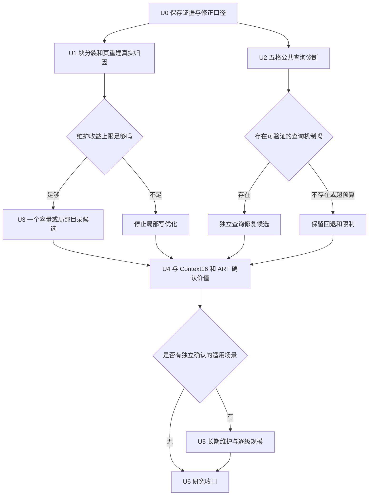

# BM：T2 回滚后的长期执行计划（2026-10-29）

**状态：仅制定计划；本文件中的新工具、实验和结构候选均未实施。** 起点为 `f4e79bfa244a2adbddb802fa9f46ac63b1d07d8f`。承接 [10-28 方案](LONG_TERM_BM_TARGETED_OPTIMIZATION_20261028.md)，依据 T1–T4 实际结果调整执行顺序，不重置已经用完的实现预算。

下一步目标分为两层：先在约一周内回答“剩余块维护是否值得优化、查询回退由什么引起”；再用有限预算判断 BM 是否有相对 Context16 的实际使用价值。局部写优化停止，不代表查询、长期维护和适用场景已经验收完成。

主线预算 **17–25 个有效工作日、约 4–6 周**，按条件放行，可提前结束。另有一个最多 10 个工作日的条件架构研究分支，不自动启动。时间为投入上限，不是收益或完成日期承诺。

## 1. 本轮核对后的起点

### 1.1 继承并保留的决定

| 方向 | 本轮继承状态 | 后续处理 |
|---|---|---|
| T2 跳过第二次查重 | 16 进程复测未形成足够新增收益证据，已回滚 | 停止；不再为 1–2 pp 追加重复，也不恢复实现。 |
| T3 entry 粒度 arena free list | 两次机会用完，当前夹具没有显示空间改善 | 停止；不换名字再做第三次 free list/coalescing。 |
| T4 scan 分配优化 | 未立项 | 保持；除非出现新的耗时归因或真实业务价值证据。 |
| 块容量/局部目录 | 尚未得到有效的事件级成本份额 | 只允许先测量；达到收益门才实现。 |
| 正确分组的公共 find 回退 | 5 格确认回退，17 格未定 | 仍需诊断；T1 的单键成本夹具没有完成此项。 |
| Context16 默认 | 保留 | BM 候选继续通过独立实验 factory。 |

BM0 指 `make_bm_experiment_index({})`，BM1 指回滚后当前 `make_bm_split_experiment_index({})`。未来容量候选称 C1，查询候选称 Q1，避免把已经撤回的 T2 实现继续叫“当前候选”。这些名称只是计划编号。

### 1.2 代码回滚和工作区状态分开记录

本轮实际核对：`bm_n1_page_core.hpp`、`bm_n1_index.hpp`、`bm_split_index.hpp`、`bm_split_adapter.hpp` 相对 `64523e4` 无内容变化，支持“核心恢复到此前验收版本”。但整个工作区仍有 **7 个已跟踪修改、862 个未跟踪状态项**，并非全仓库干净；未跟踪状态项数不是递归文件数。

T0 已提交文本与工具，部分原始轨迹、验收日志仍仅在本地。T1–T3 的运行目录也在 `builds/`。本计划不修改其他会话文件，不自动提交或公开发布这批原始证据。

继承性能状态：写门 29/32；终态查询 10 通过、5 回退、17 未定。ART 写耗时 3.87–16.84 倍、Context16 吞吐比中位数 0.584 来自此前配对记录的描述性汇总，**不是 T2 对全部 baseline 的新增正式验收**。包装门、故障字面轮、100k 生成复现继续继承各自实际覆盖范围，不重新登记为缺口。

### 1.3 新计划必须修正的证据口径

以下核对来自已存在的源码和记录，不是本轮重跑实验。它们不改变停止 T2/free list 的决定，但会改变后续归因方法。

| 既有说法 | 实际测量/代码 | 本计划采用的表述 |
|---|---|---|
| 每次块分裂复制 1.0–1.3 KB | T1 用 `(bytes_after−bytes_before)/maintenance.rebuilds`；分母是页重建次数，分子是全索引净驻留增量 | 不能代表块分裂次数或复制量；真实数据移动成本尚未测清。 |
| 第二次查重占插入成本 12%–24% | T1 比较同一个现存键的 `find_base` 与拒绝插入；Index 在第一次 find 命中后立即返回 | 没有执行第二次查重，不能估计成功插入的重复定位成本；还混入 map/root 路由和不同页内查询路径。 |
| 初次收益已证明是噪声、增益只有 1–2 pp | T2 的 CI 是修改版/BM0；“改前/改后”差值另减历史汇总，没有同时测未修改 BM1，也没有差值 CI | 严格结论为“未建立可合入的新增收益证据”；无需为证明零收益重新实现 T2。缓存解释仍是待验证解释。 |
| 插入只占此次增长格写请求的一部分 | 本轮八格 growth manifest 中 update=erase=0，write_us 仅统计成功插入 | 读请求比例影响混合吞吐，不会稀释这些格的 write_us。替换格才有 2:1:1 写操作构成。 |
| scan 时间最多优化约 10% | 来自约 6–8 次可省分配占分配次数的比例，没有对应耗时归因 | 分配次数占比不能作为时间上限；拥有式字符串接口成本也由其他 baseline 共同承担。保持不立项，不外推劣势原因。 |
| free list 对真实替换都无效、arena 全局单调增长 | 夹具删除源键，再插入 `~arena/` 等合成键；未覆盖同页真实替换与长时间重建 | 只说明本次实现/夹具未显示收益；页内追加直到重建的已知行为，与全索引长期是否稳态是两回事。 |

补充：T3 第一次存在越界/错误槽位，属于实现失败；第二次通过已跑语义门，也不等于完成新增分配、fence 引用、异常安全的全域证明。已回滚即可，不在本轮补验失败实现。

因此，“现有几条局部方案已经停止”成立；“当前索引的全部机制空间耗尽”尚无充分证据。下一轮不需要证明所有可能机制，只需对剩余值得投入的方向给出有限、可复核的决定。

## 2. 新的决策顺序

U1 和 U2 可以独立开展，避免把所有精力再次放在写路径微调。只有通过 U4 的场景进入长时间和大规模验证。新维护架构另走第 10 节的条件分支。

## 3. U0：保存当前证据，冻结新协议（1 天）

### 执行步骤

1. **冻结身份。** 记录 f4e79bf、BM0/BM1/Context16/ART 的实际源码闭包、模型与 benchmark pin、编译器及选项、输入 SHA、主机/CPU 亲和性。核心回滚的内容哈希与 git 状态分别保存。
2. **保护不可再生记录。** 只读复制 T1/T2/T3 的现存原始输出和构建日志到新的证据目录，列出缺失项；记录 T2 现存二进制 SHA，但没有编译时闭包就明确其身份绑定不完整，不能事后补一个 SHA 冒充原始绑定。
3. **保存历史局限。** T1 脚本没落盘的 stdout 不视为有原始 JSON；T2 confirm 截断了同目录初次输出，4 进程数据若找不到，登记缺失，不能从报告数字重造原始样本。
4. **登记口径补篇。** 用独立文件记录第 1.3 节，给历史报告增加指针属于执行阶段工作；不删除失败报告，不把历史判据重写成新判据。
5. **冻结新指标。** 明确本轮计量的是新增候选/BM1；BM0 用来证明原成果保留，Context16/ART 用来判断实际价值。候选/BM0 的区间不能代替候选/BM1 的增量区间。
6. **准备新入口。** 按 README §4 的正式 runner 纪律：真实闭包/二进制哈希、唯一临时产物、原子发布、运行前后漂移核对、新结果目录；运行中不改被测源码，不复用身份未知的旧 `pure`。

### 交付与停止条件

交付 `identity.json`、输入清单、证据缺失清单、协议及机制台账。原始文件是否全部放 Git 可单独决定；启动后续测量的前提是有不可覆盖的证据快照与哈希清单，不必等待 200 MB 历史文件的仓库策略。

最多一天，不全面重跑历史验收。T2 和 free list 保持停止，不以“口径有局限”为理由追加实现机会。

## 4. U1：块容量/局部目录的定量实验（2–3 天）

**唯一要回答的问题：在当前 BM1 的实际写成本里，块分裂的数组复制、分配与释放究竟占多少？页重建又占多少？** 本阶段只增加诊断工具，不改变布局、容量策略或生产路径。

### 4.1 三种量必须分开

| 量 | 获取方式 | 能回答什么 |
|---|---|---|
| 净驻留增量 | 操作前后同一账本的 live requested bytes | 操作后多占多少空间 |
| 逻辑移动字节 | 实际执行的旧 block/fence 元素复制数 × sizeof，另计新元素构造 | 算法移动工作量；不等于硬件 DRAM 流量 |
| 时间成本 | 分配、元素复制、构造/发布、旧数组释放各自的排他计时 | 对写耗时和混合吞吐的真实贡献 |

例如 B 个旧块搬入新数组时，旧块移动量随 B 增长，净空间却可能只增加一个块。两者不能互相替代。`sizeof(Block)` 和 fence 大小从实际编译记录，不用硬编码 ABI 假设。

### 4.2 先做路径自检夹具

1. 新建页级诊断副本，构造满块但页未满、prefix 不变、arena 足够的状态。
2. 插入一个不存在的合法键，证明 `block_splits` 恰加 1、页 rebuild 加 0；核对 size、全部键值、scan、verify。
3. 独立构造 page_full、arena_short、prefix_change 三条页重建路径；原因是互斥主标签，其他同时满足的条件作为附加字段，避免重复计时。
4. 诊断新计数器单独编译，通过空计时/无事件对照估计开销；若开销大到无法区分目标份额，结论记为未定，不能用其上界直接批准改造。

### 4.3 两层负载

- **合成路径矩阵**：页内块数约 8/32/64/128，插入位置首/中/尾；每组准备足够后缀余量，只触发一次目标分裂，下一样本从相同状态重建。用于验证复杂度和复制账本，不代表真实业务频率。
- **真实轨迹矩阵**：先选 words 80/20 均匀增长、URLs 80/20 热点增长、words_100k 95/5 均匀替换、URLs 80/20 热点替换；如频率差异明显，再补 words_indep 的一个增长与一个替换格。最多 6 格，不立刻扩 32 格。

每格记录成功 insert/update/erase 数，普通插入、块分裂、三类页重建的次数、总耗时、分位、分配数、移动字节、block 数、arena live/used/capacity。页重建进一步拆到 rows 提取、编码/tag、fence、BM fit、root、释放；不重叠相加。

### 4.4 收益上限与批准规则

定义 `p_write = 块分裂中可优化部分耗时 / 全部成功写耗时`；另算 `p_mix`，但必须在与正式混合通道校准过的成本副本上解释，不拿逐操作时钟的绝对占比当纯吞吐事实。

先算不可能超过的理想上限，再用保守可减少比例 r 估计：写耗时可降约 `p_write×r`，吞吐增益约 `1/(1−p_mix×r)`。r 必须说明来自何种受控测量，不能默认 100%。

| 结果 | 决策 |
|---|---|
| 理想写节省 <10%，或不能支持有价值的系统收益 | 停止容量/局部目录实现；保留成本证据。 |
| 理想写节省 10%–15% | 本轮仍不做结构改造；如能直接修查询，转入独立 Q1 登记。 |
| 保守估计写节省 ≥15%，且混合吞吐可达 ≥1.10× | 才允许 U3；同时证明空间预算可容纳。 |
| 计量仍不可靠 | 在本阶段最多一次修正测量；仍未定就停止，不以“可能很大”批准实现。 |

如果主要成本是整页编码，就明确容量策略不能解决；不要把页重建耗时算进块数组优化的可消除部分。若某格当前写耗时是 ART 的 12 倍，要到 2 倍需下降约 83.3%；消除一个 10% 份额无法达到这个目标。此为成本算术，不是新性能预测。

**交付**：逐路径账本、6 格以内的频率×成本表、容量方向的 go/no-go。没有候选也是阶段完成。

## 5. U2：公共 find 的查询回退诊断（3–4 天）

### 5.1 固定对象与问题

沿用正确分组复验的最终存活集与 manifest 热区，先覆盖五个确认回退格：

1. words / 80:20 / uniform / growth；
2. URLs / 95:5 / uniform / growth；
3. URLs / 80:20 / hotspot / growth；
4. words_indep / 80:20 / uniform / growth；
5. words_indep / 80:20 / hotspot / growth。

追加两个已通过格作正常对照，选择与风险格相同语料/接近规模的场景，并在运行前写入协议。17 个未定格不用于挑选“漂亮对照”。

### 5.2 五步诊断

1. **重建一致状态**：BM0、BM1 分别重放同轨迹；C++ oracle 核对终态 map；从该 map 建各自快照。数据和查询哈希沿用正式复验，不重新筛“热点”。
2. **公共路径计数**：从 adapter 的 `find_base` 到页内窗口验证，记录窗口宽度、边界比较、fallback、directory steps、实际 block 访问、tag 候选、完整字符串比较；内部 `find_counted` 不代替公共路径。
3. **同布局消融**：同一 BM1 payload 上只改变窗口路由、单块纠正、fence 二分之一；记录 payload identity。诊断模式存在不代表切换默认，也不重新启用历史失败配置。
4. **模型与布局分开**：只在同 fence、同 payload 上测试重训模型的影响；另比较动态终态与重建快照。如果同时改变 prefix、block layout 和模型，就不能定位原因。
5. **无计数重测**：只有工作量变化和无统计完整 find 耗时同向、跨进程稳定，才把解释提升为机制证据。工作量不变时，允许一次地址布局/缓存计数对照；无权限或无工具时记缺失，不用“同一缓存行”填补。

诊断容器可以分配；正式 find 必须保持零分配。对 absent、prefix mismatch、二进制边界键给出同等覆盖，不能只让命中查询变快。

### 5.3 条件查询候选 Q1

- 若模型块序漂移成立：只试一种确定性页级模型刷新，训练/临时模型/发布成本计入维护与空间。
- 若多候选块验证主导：只试一种保留完整边界证书的单块定位方案，作为新登记入口；不能删去 miss 纠错或假定模型半径是缺席证明。
- 若仍未定位：到时停止机制实现，保留五格回退和其他未定。不以吞吐提升抵消查询门，也不为了“收口”宣称无回退。

Q1 最多两次实现，单独身份、单独结果。查询修复要求五格相对 BM0 的完整查询区间上界 ≤1.05；同时相对 BM1 读不退化、写与混合性能不回退 >5%，终态/维护峰值继续守门。Q1 不强求新增写收益 ≥15%。

**交付**：七格查询工作量与完整耗时配对表、被排除解释、最多一个 Q1；或明确的查询限制报告。终态查询通过之后，交错混合 find 仍须单独验收。

## 6. U3：一个条件容量候选（3–5 天，只在 U1 批准后）

### 设计和实现顺序

1. 先写一页设计：保持什么布局、每页最多多多少字节、最坏移动量、查询如何定位、故障时如何保留旧状态。新接口拟命名 `make_bm_capacity_experiment_index`，实现前不存在。
2. 优先验证有界额外容量能否在**实际分裂算法**中复用。当前代码即使旧 vector 有 spare capacity，仍会新建 next_blocks/next_fences；只在构造器 reserve 更多空间不会自动省掉这些分配，不能把它当已实现优化。
3. 为两组数组设计一次性提交：第二处分配失败时不能留下记账失配；扩容后按索引重新取元素，不能继续使用失效引用。先明确原保证包括的逻辑状态和请求字节状态，再验收，不能结果出来后缩窄保证。
4. 若额外空间或异常发布成本已经吃掉收益，停止。最多一次新的独立设计机会可改成稳定块组/局部目录，但需 U1 证据支持，且额外间接访问不能恶化 find。
5. 先跑路径夹具与受影响的故障点，再跑 4 个核心格，最后才扩正式范围。C1 与 Q1 各自过门以后才允许组合；组合视为新身份重新测，不继承单项成绩。

### 保留门

- 新候选/BM1：目标写耗时 95% 区间上界 ≤0.85；纯混合吞吐区间下界 ≥1.10；非目标写/读/扫描上界 ≤1.05。
- 新候选/BM0：保留原有写收益，查询不得靠比一个本已回退的 BM1 略快而过门。
- 同轨迹终态 requested bytes 相对 BM0/BM1 均 ≤1.05；维护峰值均 ≤1.10；构建峰值、RSS 分开披露。
- 新分配路径逐点注入，三语料+字节夹具、opt+sanitizer、失败后 1,000 次插入/删除、销毁归零。公共 factory contract 和 scan 顺序/值检查必须覆盖。

最多两个实现，超过 5 天或仍有任一硬门失败即停止。不再追加“预留更多”“只换增长因子”等参数轮次。

## 7. U4：确认相对 baseline 的实际价值（3–4 天）

即使 U3 不成立，也可对已冻结 BM1 做一次有边界的价值确认；这轮不能继续修改结构。若 Q1 未过门，目标范围必须披露查询限制，不能评为默认可替代。

### 7.1 有限矩阵

优先覆盖两个历史观察领先 Context16 的 URLs 80/20 替换格，以及它们的均匀/热点配对和 95/5 对照，最多 8 格。冻结一个新的 seed 和未参与调参的真实数据切分，再运行确认；旧格是发现集，不兼作独立成功证据。

同时设一组 words 失败对照，防止报告只留下胜出语料。每格比较 BM0、BM1、冻结的新候选（如有）、Context16、ART；若没有新候选就是四臂，不硬凑五臂。

每组生成两条明确不同的负载：保留 scan 16/128 的原混合负载；从相同点操作序列删除 scan 的点操作负载。各自单独哈希和审计。ART scan 从头遍历的 adapter 特性写在混合比较表旁，点操作组才用于评估与 ART 的查找/写入差距。

### 7.2 指标与价值门

全部报告绝对耗时、完整 find、insert/update/erase、scan、纯混合吞吐及其自身 A/A。内存同一 requested-byte 账本包含 adapter、索引、临时结构和版本重叠；输入/预言机排除且保持各臂相同，RSS 另列。

沿用 10-28 方案的建议值，在首次运行前定稿，不按结果改线：

| 价值路径 | 必须同时满足 |
|---|---|
| 吞吐价值 | 相对 Context16 纯吞吐 CI 下界 ≥1.10，完整 find 上界 ≤1.05，终态/维护峰值不超过 Context16 的 1.05/1.10；语义全过。 |
| 空间价值 | 终态 requested bytes ≤0.80×Context16，纯吞吐 CI 下界 ≥1/1.10，完整 find 上界 ≤1.05，并满足登记的维护/尾延迟预算。 |
| 仅研究价值 | 对 BM0 有稳定改善，但前两条未过 |

ART 的点操作耗时与空间必须同表披露；不能只选择对 BM 有利的 baseline。BM 的 owning-string 契约同样适用于 Context16/ART，不能先把公共接口成本扣掉再声称算法领先。

独立确认仍没有适用场景，就进入 U6；不为了使已有成果“有用”扩到所有读写比例寻找事后赢家。

## 8. U5：长期维护与逐级规模（3–5 天，条件阶段）

只有 U4 在至少一个预登记范围确认有价值，才值得在该范围验证生命周期和规模。先做两个核心格，不启动百万全矩阵。

### 8.1 真键周转步骤

1. 使用数量足够的真实唯一键池，固定活跃数，成功 update:erase:insert=2:1:1；池不足时允许对已删除真实键做后续重插，但要报告这种稳态语义，不能称为全程全新键增长。
2. 每页记录删除键/新键的后缀长度分布、是否同页、prefix change、arena live/used/reserved、仍被 fence 或模型借用的字节。free list 没有收益不意味着这些字节都可安全复用。
3. 最少计划 3 次完整活跃集周转，最多 10 次；另有 1,000 万操作硬预算，运行前核算是否够完成 3 次。达不到则标记覆盖不足，不用总操作数冒充周转数。
4. 分别测试不主动 compact 和确定阈值触发 compact；阈值、检查间隔先登记。compact 全耗时、暂停和峰值计入结果，不能放在计时区外。
5. 在真实替换之外补“删除 50% → 扫描 → 回填”一次，验证空块、稀疏页、重新插入后的读写与空间；90% 删除列为条件追加，不必默认扩表。

每个检查点核对全量 live map、扫描顺序和值；记录重建原因、频率和 p95/p99。事件不足时报告 max 和样本数，不生成无支撑的 p999。

稳定性要求：同活跃数 bytes/live-key 在第 3 至第 10 周转不持续增长超过 10%；维护 p99 相对 BM1 不回退 >10%，同时披露绝对暂停。只完成 3 周转，只能给出初步生命周期证据，不能宣称 10 周转稳态。

### 8.2 规模顺序

先补已存在 100k words 的同协议读/写/空间，再到 250k 实际活跃键，最后才考虑百万实际活跃键。源池大小、初始/终态 live 数各列一栏。

URLs/其他语料不足就停在数据覆盖边界；获取额外真实来源后单独登记来源、原文件哈希、去重和采样，不能用合成后缀扩写冒充真实大规模。先做内存和总时长预估，出现换页或机器变化时另成批次。

规模阶段每阶最多 4 格。任一级空间、查询、维护或价值门失败，停止下一阶。大规模结果可以成为未来结构设计输入，不反向追认小规模通过。

## 9. U6：交付最终可复核结论（2–3 天）

冻结一个通过的版本或明确的回滚版本，输出以下四张表：

1. **完整性能表**：BM0/BM1/最终候选/Context16/ART，逐格绝对耗时、比值、A/A、CI、pass/regression/undecided/measurement_unresolved。
2. **空间和生命周期表**：终态、构建峰值、维护峰值、RSS、live/垃圾/fence 引用字节、compact 代价、尾延迟。
3. **机制台账**：已停止的 T2、free list、scan，剩余容量方向的真实上限，查询解释，失败原因和预算；区分实现失败、缺少证据、性能无足够价值。
4. **复现与采用边界**：版本、源闭包、输入/二进制哈希、完整原始记录位置、数据获取方式、命令、未覆盖范围。对外复现需要可获取的输入/证据，不只有 summary。

核心不变时复用其已有验收覆盖；改变分配、fence、模型、目录或回收路径时，重跑受影响门，不能用 S0 的旧通过代替。最终在新隔离目录验证重建和最小复现链。

允许的最终结论：限定场景可选实验；BM 优化研究成果；当前目标不值得继续投入。所有结论都可收口，不把默认切换作为必须完成的任务。

## 10. 可选的新架构研究：BM 稳定基页 + 有界增量（另立登记，最多 10 天）

这是长期路线中的**条件研究分支**，不是已批准实现，也不是给 free list 或 T2 追加机会。

### 10.1 启动条件

必须同时具备：

- U1 证明整体写差距主要来自频繁整页编码/重建，容量小改无法解决；
- U4 测到 BM 有真实空间优势或明确任务价值，保留 BM 有理由；
- 查询新增探测、delta 元数据和合并峰值的成本模型在既定预算内可能成立；
- 完成独立设计与协议登记，写清新分支的目标场景和停止线。

若只是“其他方向都失败，所以再试一个”，不启动。若 U4 连价值场景都没有，主线以研究收口结束。

### 10.2 设计假设

保留每页稳定的 BM base，把少量新键、值替换和 tombstone 写入有界 delta；达到阈值后，对该页合并并重新建模。它改变的是维护粒度和时机，不更换上游 BlockModel。

潜在收益：将多次页编码摊到多次修改。新增代价：每次读要判断 delta；扫描要按键合并；tombstone/新值需严格优先；临时新旧页和 delta 一起占峰值。容量小不等于开销一定小，必须计入每键元数据和字符串。

### 10.3 先计算，再决定实现

第 1–2 天只用事件日志计算：

`每次修改摊还成本 = delta 查找/修改 + 每次合并总成本 / 合并间成功修改数`

`每次 find 成本 = root + delta 探测 + 未在 delta 解决时的 BM 完整查找`

`维护峰值 = 旧 base + 新 base + delta + 合并暂存 + 全局其他页面`

重复更新同一键、持续全新键增长、真实键替换分开算，不能用热点多次 update 的摊还收益代表增长。delta 命中率和重写放大必须来自轨迹，不能假定所有读都跳过 BM。

若估计不能满足相对 BM1 写耗时 ≤0.70、纯吞吐 ≥1.20，且查询 ≤1.05、终态/维护峰值 ≤1.05/1.10，就停止设计；这是新架构分支的立项门，不改写旧机制的门。

### 10.4 单一最小原型（条件满足后第 3–7 天）

只选一种 delta 容器和一个由成本模型确定的容量；最多再给一个预登记容量对照，不做多参数搜索。原型只进入新实验 factory。

必须先定义并验证：

- insert 查重覆盖 base+delta；update/erase 区分不存在、base 存在和 delta 存在；删除后重插覆盖 tombstone。
- delta 先于 base 给出最新答案；find 全程零分配；新键跨旧 prefix 时路由与 miss 仍正确。
- scan 两路有序合并、去重、跳过 tombstone，返回拥有式字符串，严格执行 lower_bound/limit。
- 合并旁路构建成功后一次发布；任何分配失败保留原索引可读可写；每个新增分配点都有故障注入。
- fence 和模型借用的字节存活到所有引用释放；不能在压缩时复用仍被借用的字符串。
- 合并开始/结束都计时，不做未计入的后台维护。

### 10.5 第 8–10 天确认或停止

先 4 个代表格、后独立 seed，直接比较新架构/BM1，并保留 BM0、Context16、ART 对照。即使写入显著变快，只要查询、空间、语义或尾延迟失败，就不通过。

最多一个结构原型和一次有证据的修正。到 10 天无完整通过则停止。混合多模型、通用根重写、无界缓冲、并发/持久化和接口更换不顺带加入；它们均需独立任务。

## 11. 测量与统计纪律：避免下一次“试跑通过、确认撤回”

- **直接比较新增量。** 新候选和未改 BM1 必须同一批独立进程块、同输入运行；BM0 仅是额外锚点。直接计算新/BM1，不减历史百分比，不用两条各自的 CI 是否重叠代替差值检验。
- **试跑只找工具问题。** 4 个进程用于语义、计时和触发率核对；不写“已通过性能门”。正式确认固定 16 个进程、每进程 8 个配对重复，进程内重复聚合后才算区间；动态重复各自从相同初态重建。
- **计量三通道。** oracle/事件统计、单操作延迟、纯混合吞吐用不同副本；纯通道无逐操作时钟和路径日志，保留两次 pure 耗时及完整结果校验和。
- **A/A 属于对应指标。** 每臂、每指标各自的 A/A 95% 区间都在 `[1/1.05,1.05]` 内，质量才通过；不能借写入 A/A 验证 find 或 pure 吞吐。
- **计时批长先定。** 可批量的终态查询先校准至少 40ms。动态混合重复必须从相同初始状态开始、每次重建不在操作计时内；加长操作数需生成并审计新轨迹，不能对已变更索引重复同一写轨迹凑时长。
- **保留不利样本。** 不取最小、不中途删重复，不看到结果再加进程。最多一次预登记的批长修正，作为完整新批次保留；仍未定则停止本轮判定。
- **统计方法统一但不追认历史。** 新候选/BM1 在 log 空间做进程配对比，t 区间 df=n−1；旧 29/32 写门保留原算术比口径，不混成一个总 CI。
- **多格结论有边界。** 探索报告逐格 95% 区间；正式“目标范围均通过”预先列出全部主比较，使用 Bonferroni 同时区间（总主比较数 m，双侧每项 α=0.05/m）。未定不算通过，不能声称逐格 95% 就是全域同时 95%。
- **顺序与身份真实。** 四臂/五臂各自平衡顺序；闭包和二进制 SHA 用真实值，不能再用 `t2` 等占位身份；编译、测量、分析变更都绑定到新记录。
- **机制解释要有对照。** 份额、字节、频次、分配与耗时分别报告；没有缓存计数对照就写“可能缓存因素”，不能写“同一条缓存行已证实”。

这些要求是为了下一轮结果可决策；U0 不因此无限扩为全面审计。

## 12. 执行文件、产物和责任范围

以下为未来执行时的拟新增文件，不表示本轮已经创建可运行程序。优先复用现行 runner 的构建/身份模块，避免复制一套松散 shell。

| 产物/工具 | 职责 | 不应承担 |
|---|---|---|
| `docs/PROTOCOL_BM_POST_T2_*.md` | 固定格、主指标、预算、样本数、判据 | 结果出来后调整成功定义 |
| `diagnostics/diag_bm_block_cost_v2.cpp` | 区分块 split/页 rebuild，测逻辑移动字节与时间 | 替换正式吞吐驱动 |
| `diagnostics/diag_bm_query_work_v2.cpp` | 公共 find、同 payload 消融和 miss 证书检查 | 静默切换 factory 默认查询 |
| `tools/run_bm_post_t2.py` | 新目录、真实身份、A/A、轮转、原始记录 | 运行时修改核心、覆盖 builds 历史输出 |
| `results/bm_post_t2_<stage>_<runid>/` | identity/manifest/raw/summary/decision/失败日志 | 仅保留汇总或复用旧 runid |
| `docs/BM_MECHANISM_LEDGER_*.md` | 预算、状态、证据和 go/no-go | 把实现失败归类为机制被证伪 |

容量或 delta 结构实现只修改其独立实验文件；BM0、回滚 BM1、Context16 作为冻结对照。共同头文件若需更改，必须显式扩展影响范围和验收，不在并行会话工作上直接覆盖。

## 13. 排期和阶段结束必须回答的问题

| 阶段 | 有效工作日 | 放行条件 | 交付/决策 |
|---|---:|---|---|
| U0 起点与协议 | 1 | 当前记录可读取 | 证据快照、口径补篇、冻结协议 |
| U1 真实成本 | 2–3 | U0 | 块容量/局部目录值得实现还是停止？ |
| U2 公共查询 | 3–4 | U0；可与 U1 独立安排 | 五格回退机制和最多一个 Q1 |
| U3 条件容量候选 | 3–5 | U1 保守收益与空间批准 | C1 通过完整门或回滚 |
| U4 价值确认 | 3–4 | 冻结被测版本 | 相对 Context16/ART 是否有独立确认价值？ |
| U5 生命周期/规模 | 3–5 | U4 至少一个场景通过 | 长期维护能否稳态，规模是否可扩？ |
| U6 收口 | 2–3 | 可以在任何停止节点开始 | 最终表、限制和可复现包 |

全部顺序执行为 17–25 日；跳过 U3/U5 会缩短。第一周应完成 U0/U1 并形成 U2 的机制证据，不能第一周末仍只有新的实验清单。架构分支最多另加 10 日，启动门未过就不投入。

周度登记只保留这些字段：机制 ID、父版本、输入哈希、目标格、预计上限、实现次数、已花工作日、当前 verdict、证据位置、下一决定。到阶段上限必须明确停止/进入下一阶段，不以“再测一轮”延长。

### 立即执行的前十项（供下一位执行者按序领取）

1. 保存 f4e79bf 和四个回滚核心文件内容哈希，记录全工作区仍有其他改动。
2. 保存 `builds/t2_20261029/*.jsonl` 等现存记录；缺失的 4 进程原始数据登记缺失。
3. 登记第 1.3 节口径补篇，保留 T2/free list 停止结论。
4. 冻结 U1 六格上限与 U2 五个风险格/两个正常对照。
5. 为块 split、page_full、arena_short、prefix_change 各做一个能核对事件计数的夹具。
6. 记录实际 blocks/fences 复制数、分配/释放和排他时间，替换净内存差值估计。
7. 用真实轨迹得出频率×成本与收益上限；提交容量 go/no-go 决定。
8. 收集真实公共 `find_base` 工作量，运行同 payload 路由消融。
9. 只为有因果证据且满足预算的方向登记一个候选；没有就停止实现。
10. 冻结版本后完成有限的 Context16/ART 价值确认，再决定长期负载、大规模或最终收口。

## 14. 当前证据索引

- [本轮只读核对与原始记录复算](BM_POST_T2_STATE_20261029.json)：f4e79bf、源文件 SHA、T2 八格现存 JSONL、manifest 操作构成；没有新增 benchmark。
- [T2 最终判定](../07_Eval_Integration/RESULTS_BM_T2_VERDICT_20261029.md)、[T2 初次报告](../07_Eval_Integration/RESULTS_BM_T2_SINGLE_LOOKUP_20261029.md)、[T1 账本](../07_Eval_Integration/RESULTS_BM_T1_COST_20261028.md)、[T0](../07_Eval_Integration/RESULTS_BM_T0_FREEZE_20261028.md)。
- [T3 尝试 1](../07_Eval_Integration/RESULTS_BM_T3_ATTEMPT1_20261028.md)、[T3 尝试 2](../07_Eval_Integration/RESULTS_BM_T3_ATTEMPT2_20261028.md)、[T4 判定](../07_Eval_Integration/RESULTS_BM_T4_SCAN_20261029.md)。
- [T1 实际夹具](../07_Eval_Integration/diagnostics/diag_bm_cost_t1.cpp)、[T2 confirm](../tools/t2_confirm.sh)、[T2 measure](../tools/t2_measure.sh)、[原计时驱动](../07_Eval_Integration/diagnostics/bench_bm_pure.cpp)。
- [正确分组查询报告](../07_Eval_Integration/RESULTS_BM_QUERY_RECHECK_20261024.md)、[验收缺口第二版](../07_Eval_Integration/RESULTS_BM_ACCEPTANCE_GAPS_20261025.md)、[10-28 详细方案](LONG_TERM_BM_TARGETED_OPTIMIZATION_20261028.md)。
- [页核](../07_Eval_Integration/diagnostics/bm_n1_page_core.hpp)、[Index](../07_Eval_Integration/diagnostics/bm_split_index.hpp)、[adapter](../07_Eval_Integration/diagnostics/bm_split_adapter.hpp)、[物理块结构](../02_Code_and_Experiments/validation_e25_20260918/static_physical_index.hpp)。
