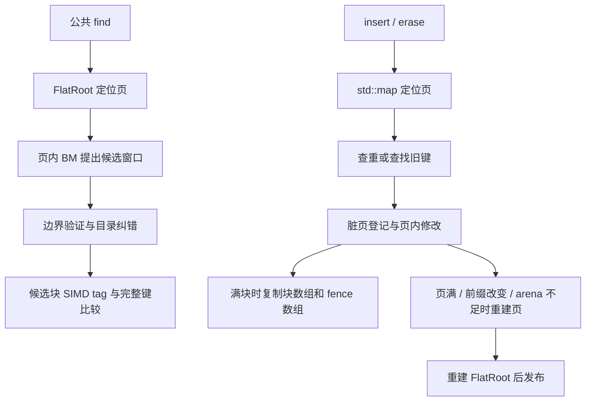

# BM 当前结构的长期优化方案（2026-10-28）

> **2026-10-29 执行更新**：T2 单次查重优化已停止并回滚，T3 free list 两次机会已用完，T4 scan 暂不立项。后续顺序、证据口径与预算以 [T2 回滚后的长期执行计划](LONG_TERM_BM_POST_T2_PLAN_20261029.md) 为准。下文保留 10-28 的首次登记内容，其中“未执行”等状态描述属于当时快照。

状态：**方案已制定，以下新实验尚未执行。** 本轮只读取代码、核对证据、重算既有记录并编写方案，没有修改索引或启动性能测试。

主张：保留 Context16 默认，把 BM 的下一轮工作集中在**消除已确认查询回退、减少写路径重复工作、降低块/页维护成本**。先证明成本来自哪里，再选择一种结构改动；不以继续扩大矩阵代替优化，也不把优于原 BM 当成优于生产 baseline。

建议投入：约 **6–8 周、27–40 个有效工作日上限**，按阶段放行。前两阶段约一周就应交付可执行的机制判断；若证据不支持后续改造，应提前收口。日期和收益都是计划，不是完成承诺。

## 1. 当前状态：哪些已经完成，哪些仍然不足

### 1.1 版本与证据边界

- 本次核对 HEAD：`64523e41dddf3a9aa1144a9599e9738019a3533d`。最新验收补篇、包装门、故障补充、生成器与构建纪律修复仍包含未提交文件，不能把当前工作区称为“HEAD 已包含全部成果”。
- `bm_n1_page_core.hpp`、`bm_split_index.hpp`、`bm_split_adapter.hpp`、`bm_n1_page_root.hpp` 四个候选核心/接入文件相对 HEAD 无差异。性能结论没有因这些本地验收补篇而发生算法层面的更新。
- 当前 `origin/main` 缓存引用显示本地领先 17 个提交；这不是本轮刷新远程后的推送状态，也不是再次推送授权。本计划不提交或推送其他会话的工作。
- 本轮实际查询两上游默认分支：benchmark 仍为 `003a55bf674b43350fbb70242070fb74f33a56ce`，模型仍为 `3894c767338a865d2920ba5e21283827fea1d803`，与现有实验 pin 一致。原模型仓库链接现在解析为 [Zephyr761/Learned-Index-Model](https://github.com/Zephyr761/Learned-Index-Model)；benchmark 为 [zsh20070718/learned-index](https://github.com/zsh20070718/learned-index)。本轮不升级依赖。
- 本轮源文件/证据哈希、逐格描述性复算保存在 [状态快照](BM_OPTIMIZATION_STATE_20261028.json)。它记录的是本地证据，不是新增 benchmark 结果。

### 1.2 三种 baseline 必须分开

| 名称 | 角色 | 回答的问题 |
|---|---|---|
| BM0：`make_bm_experiment_index({})` | 原 BM 页实验基线 | 块内再平衡及后续机制是否改善了 BM？ |
| BM1：`make_bm_split_experiment_index({})` | 当前块内再平衡版本 | 下一次改动是否在当前成果上继续获益？ |
| Context16：当前冻结生产配置 | 默认方案对照 | BM 是否有值得部署的场景？ |
| ART：当前正式 adapter | 外部点操作基线 | 写入和点查询距离成熟结构还有多远？ |
| BM2 | 未来单机制候选的占位名 | 只能在登记并实际实现后成为测试臂，当前不存在。 |

本轮没有同协议的最新 LITS 全矩阵，不给出 LITS 当前排名，也不把“重新接入一种模型”列为主线。上游 BlockModel 保持不变，首先改进它周围的索引结构。

### 1.3 最新数字与有效范围

| 指标 | 当前证据 | 对计划的影响 |
|---|---|---|
| BM1 相对 BM0 写收益 | 32 格中 29 格满足 ≥15% 的配对区间门；增长 16/16，真实替换 13/16 | 增长优化成立；替换中的稀疏均匀写仍是薄弱点。 |
| BM1/BM0 终态完整查询 | 10 通过、5 确认回退、5 区间跨门、12 A/A 质量未定；5 个确认格中心慢 7.8%–8.7% | 查询通用采用门未通过；不能把其余 17 格当作无回退。 |
| BM1/BM0 纯混合吞吐 | 逐格配对比中位数范围 1.047–2.591，32 格中位数 1.532 | 描述性证据表明已有系统收益；不是新的置信区间验收。 |
| BM1/Context16 纯混合吞吐 | 范围 0.303–1.628，32 格中位数 0.584；仅 2 格观察值 >1 | 主要产品差距仍在；多数场景不能取代 Context16。 |
| BM1/ART 写请求耗时 | 范围 3.866–16.838，32 格中位数 11.719 | 写入仍有数量级差距；仅优化几百分点不可能普遍追平。 |
| BM1/Context16 写请求耗时 | 范围 0.493–13.635，32 格中位数 7.681；30 格 >1 | 应解释为何 URLs 的两个 80/20 替换格例外，而不是只研究 BM 内部增益。 |
| 最新包装门 | 三语料 16 进程版通过；95% CI 上界 words 1.0296、URLs 1.0273、phrases 1.0172 | 包装通常不是当前优先瓶颈；旧“上限 2.71%”已撤回，不再引用。 |
| 最新故障字面轮 | 每构建 22,739 次实际注入 +28 成功对照，271,808,717 项检查；opt/sanitizer 均零失配、销毁零泄漏 | 已补齐三语料 sanitizer 注入和每点 1,000 次插入/删除；不重复当成未完成。 |
| 100k 生成复现 | 8/8 格 rows/operations SHA 与原 manifest 一致 | 数据生成缺口已关闭；不等于补齐所有 100k 语料或性能门。 |
| 空间 | S0 既有 24 轨迹中终态约 0.999–1.0041 BM0；新 v3 全 32 格未全部重测 | 不能笼统说当前所有场景“空间零代价”，更不能据此宣称优于 Context16/ART。 |

吞吐/外部写比的计算：每格先取独立进程配对比的中位数，再描述 32 格分布；100k 旧混合写记录为 8 进程，其余为 16，新的终态查询则各为 16。没有混用进程数或把所有重复合并成一个大样本。写门的 29/32 沿用已发布算术平均配对比区间；新查询门使用 log 比区间，两者分别保留。

历史纯吞吐驱动记录 `pure_seg_us`，没有输出第二次的 `pure_seg_us_aa`，因此缺少该指标自身的完整 A/A 证据。ART 的 scan 由 `art_iter` 从头遍历并过滤 lower bound，扫描混合吞吐只能描述当前 adapter 组合，不能用来宣布 BM 普遍胜过 ART。

### 1.4 本轮不再重复的旧工作

已关闭：故障补充、包装门、100k 输入哈希复现、现行 runner 的原子发布/二进制核对纪律。历史脚本退役、重复头文件清理仍可做，但不得再次占据整个优化周期。

仍未关闭：查询 5 个回退和 17 个未定、交错混合 find 的有效新计量、新 v3 同协议空间、外部 baseline 的公平点操作比较、长期替换/删除维护、真实大规模数据覆盖。当前计划优先处理这些问题。

## 2. 当前结构给出的具体优化线索

### 2.1 读写路径

同一个索引同时维护用于读路由的 FlatRoot、用于维护和有序遍历的 `std::map`，以及脏页集合。每页最多 2,048 键，通常按 15 条装入 16 槽块。页内共享前缀，后缀存放在连续 arena，BM 对初始块 fence 训练。

**公共 find 与写路径查重不是同一种查找。** 公共 adapter 调用 `find_base`，在边界验证后的窗口内可能检查多个块；内部 `find`/`seek` 使用纠正到单块的路径。不能用内部 `find_counted` 的计数代表公共 find，不能只切换入口便声称结构优化完成。

### 2.2 已确认的代码事实、待验证的影响

| 优先级 | 代码事实 | 待验证的假设 | 需要的证据 |
|---|---|---|---|
| P0 查询 | 公共 `find_base` 使用窗口；分裂更新 fence/块编号但不立即重训 BM | 窗口宽度、旧模型与新块序关系、fallback 或访存局部性影响查询 | 同布局不同路由/模型对照；实际公共入口每查询工作量与无统计计时一致变化 |
| P0 写普通路径 | Index::insert 先 `core->find`，Page::try_insert 再 `find`，随后再做 directory 定位；erase 也有查找后再次 seek | 多次定位在不触发维护的写操作中浪费成本 | 插入/更新/删除分别拆分，普通路径占比、重复定位次数及耗时上限 |
| P1 块分裂 | 分裂 8+8，但分配并复制整页 `blocks_` 与 `stable_fences_`，不是只移动 16 条 | 在分裂频繁页，目录数组维护抵消局部再平衡收益 | 每次移动字节、分配数、块数与分裂耗时分布；不能只报分裂次数 |
| P1 页重建 | 页满、前缀改变、arena 不足都走整页抽取、编码和 root 更新 | 块优化之后，页重建或字符串 arena 成为新的主成本 | 按原因分类的频率 × 成本，prefix/编码/fit/root 各阶段计时 |
| P1 长期替换 | erase 释放条目槽但不回收 arena 后缀；默认初建仅预留约 3.125% 后缀余量 | 固定活跃键数下，历史垃圾持续触发整页重建和尾延迟 | live/used/capacity/fence 引用字节随周转曲线、重建原因及峰值 |
| P2 scan | 页、Index、adapter 分层生成/搬移输出 vector；页扫描重建完整字符串 | 多层临时缓冲与分配浪费扫描预算 | 每次输出行数、分配数、临时字节、按 scan 16/128 分开计时 |
| 条件项 根 | map 路由与 FlatRoot 重复元数据，页重建会重建 root | 页数很大时 root 开始影响耗时/空间 | 当前候选的成本占比和随活跃规模增长曲线 |

Context16 的冻结配置已开启 `write_fast_locate`、`reuse_locate_ctx`、`scan_reserve_result` 等路径优化。这提供了明确的工程对照，但不能仅凭开关名字推定它解释全部性能差距。

历史“页构建 42%–47%、根 3%–8%、复制 9%–13%”来自此前版本和负载。本轮必须重新测 BM1 的剩余成本；不能拿旧分母排除当前复制优化，也不能据此直接重做根。

## 3. 新计划的目标和决策层级

以下是**拟议的新阶段门**，只适用于之后登记的实验，不追认或修改历史门槛。

### 3.1 四层目标

1. **可信可复现**：冻结当前本地验收增量，完整记录所有版本、输入、统计规则；前期最多投入两天，不重做已经有可靠证据的全部历史实验。
2. **修复当前短板**：解释并解决查询回退，优化普通写路径，保住异常安全、空间和已有写收益。
3. **建立有价值的使用场景**：在明确读写比例、键分布、规模和维护策略下，相对 Context16 获得吞吐或空间收益，并披露相对 ART 的差距。
4. **条件探索通用替代**：只有前述结果足够好才投入大规模结构重设计。无法实现时，以限定场景或研究成果结束，属于有效结论。

### 3.2 每个候选的共同门

| 门 | 新候选要求 |
|---|---|
| 语义与异常 | 公共 factory contract、逐操作差分、scan 顺序和值、逐分配点失败回滚、继续操作、析构零泄漏全部通过；find 零分配。 |
| 查询修复 | 对当前五个确认回退格，候选/BM0 的完整查询 95% CI 上界 ≤1.05，A/A 质量独立通过；只比 BM1 快但仍慢于 BM0 超门，不算修复。 |
| 查询保底 | 正式目标场景均需候选/BM0 和候选/BM1 的查询上界 ≤1.05；终态查询与混合轨迹 find 分开过门。全域结论需要全域数据。 |
| 空间 | 同轨迹、同账本终态候选/BM0 与候选/BM1 均 ≤1.05；维护峰值均 ≤1.10；构建峰值单列。若改为空间换速度，另立独立实验，不悄悄放宽。 |
| 写/扫描机制保留 | 普通路径小改：目标操作耗时相对 BM1 CI 上界 ≤0.90；结构维护改动：目标写耗时上界 ≤0.85。非目标关键操作上界 ≤1.05。 |
| 系统收益 | 同时报告纯混合吞吐，不以单组件改善替代。结构候选进入全面推广前，预登记目标场景纯混合吞吐候选/BM1 CI 下界 ≥1.10；未达者可保留组件结论，不直接升级。 |
| 不吞掉旧收益 | BM1 已过写门的 29 格，在最终 BM0 对比中逐格复核 ≥15% 门；3 个旧失败格不能从表中消失。若限定范围，范围需事先登记。 |

查询修复候选的主收益就是恢复读预算，不强求其额外达到写入 15% 门；但必须保持写成本、吞吐和空间不恶化。小改能稳定节省 10% 普通写成本而混合收益不显著时，可以作为有证据的组件候选保留，不能描述成整体采用成功。

**生产选择建议**：默认仍 Context16。新结构只有在登记的业务范围中，完整语义/维护门通过，完整 find 相对 Context16 不回退超过 5%，并满足下列一条，才进入“显式可选配置”评审：

- 吞吐路径：纯混合吞吐相对 Context16 的 CI 下界 ≥1.10，实际终态/峰值空间分别不超过 Context16 的 1.05/1.10；或
- 空间路径：终态请求字节 ≤0.80×Context16，纯混合吞吐的 CI 下界 ≥1/1.10，且尾延迟和维护峰值符合预登记预算。

以上 20% 空间价值线是新方案的建议值，必须在测试前定稿。它不取代旧 ART 通用 ≤1.10 门或短语 0.70 研究目标。默认切换需要覆盖声明支持的全域、独立确认与运维策略；只赢两个 URLs 格不得触发默认切换。

### 3.3 研究资源按上限分配

先用 `预期整体耗时下降 ≈ 当前成本占比 p × 该组件可减少比例 r` 筛选。若某项只占写成本 5%，即使完全消除也不可能解释 15% 写收益；若只占混合耗时 3%，就不列为主要系统优化。耗时节省换成吞吐增益时使用 `1/(1-p×r)`，不能把两种百分比直接等同。

大结构改动预期整体收益不足 10% 时原则上停止；可以为了已确认的正确性/查询回退做必要修复。每个机制最多两次预登记实现、每条线到时复盘；失败后不自动追加第三次。旧尝试 A 因悬空引用失败，机制未验证，但旧预算已结束；重新研究容量策略必须另立编号，不能算“修好后免费再试”。

## 4. 测量协议：补必要缺口，控制实验规模

### 4.1 三条通道分开

1. **语义/成本通道**：允许 C++ oracle、计数器、事件级分段计时和内存账本；用于证明正确性、事件触发和解释机制，不提供正式吞吐结论。
2. **纯吞吐通道**：同一完整轨迹、返回结果纳入可观察校验和，无逐操作时钟、oracle、日志或路径统计；独立新建/重放 A、A'，输出两次 pure 时间和校验和。
3. **查询/尾延迟通道**：终态查询使用既有正确热区与存活分组；混合 find 与维护事件延迟在独立副本采集，报告采样方式、事件数和计时扰动。不能把第 3 条循环的吞吐替代第 2 条。

现有计时记录中，按“请求数 × 单次耗时”估算，BM1 写成本占比的逐格范围约 19%–80%、中位约 50%，scan 约 7%–25%、中位约 16%。它只说明值得分别关注写和扫描，**不是纯吞吐路径的精确归因**，不得拿来保证候选收益。

### 4.2 重复、A/A 与统计

- 探索试跑固定 4 个独立进程，只作发现与工具校验；确认固定 16 个进程，每进程 8 次批次重复。批长先用校准轮确定，正式 A/A 每批目标至少 40ms，不足时按已登记总查询上限处理。
- 重复先在进程内聚合，进程才是区间单位。新性能比较统一使用进程内 log 配对比、进程间 t 区间（df=n−1）；历史写门保留原统计，不混合新旧结果。
- A/A 按指标、按臂独立计算，95% 区间均落在 `[1/1.05,1.05]` 才视为质量通过。不能因 A/B 收益很大忽略 A/A，不取最小样本，不删除不利重复。
- 固定候选后才跑确认数据；每条机制最多一次事先登记的协议加长，作为新批次完整保留。仍未定则登记未定并停止该轮，不加进程直到过门。
- 三臂/四臂/五臂用各自平衡顺序，记录 CPU、亲和性、频率策略、编译器和并行负载；不将四臂轮转代码直接套到五臂。
- 探索格逐格区间不代表“全部格同时 95%”。最终采用有一个事先声明的主比较；对多格无退化声明使用同时区间或经校正检验，并在独立数据确认前冻结方法。
- 不把事后发现的两个 URLs 胜出格直接当独立成功证据。新种子、未用于调参的轨迹和第二真实样本用于确认，样本交集需披露。

### 4.3 最小矩阵与扩表规则

第一层诊断固定 **10 格**：五个已确认查询回退格；三个 95/5 均匀替换写门失败格；两个 URLs 80/20 替换的 Context16 观察胜出格。它们组成“失败 + 正对照”，不用于估计业务总体比例。

候选第一轮只测 4 个代表格（words 80/20 均匀增长、URLs 80/20 热点增长、words_100k 95/5 均匀替换、URLs 80/20 热点替换）和字节夹具；通过后扩 10 格；冻结一次版本后再跑现有 32 格和新确认集。不能每个小改都跑全 32 格。

新增外部对照负载分两组：保持已有 scan 16/128 的完整混合组；另用相同点操作序列去掉 scan 的点操作组，分别测只读、插入增长、2:1:1 真键替换。ART 点操作与扫描分开呈现；必要时引入已有可用的有序 baseline，但先过同一 contract，不用修 ART 扫描作为全部优化的前置条件。

规模写清三列：真实唯一键池 / 初始活跃数 / 终态活跃数。当前 65,536 池的增长起点是 32,768，替换起点 49,152；100k 池对应 50,000/75,000。未来“百万规模”须达到实际百万活跃键，不能拿百万源池或重复扩写键冒充。

## 5. 阶段 T0：冻结可复现起点（1–2 天）

**目标**：从当前可信本地状态建立下一轮的唯一基点，避免再把源码/工具/报告混为一个版本。

工作：

1. 列出本地验收补篇涉及的文件白名单；只整理这些文件，不卷入其他会话数百文件的成果。执行阶段形成独立提交/可恢复快照，再在隔离目录复现。
2. 保存 BM0、BM1、Context16、ART factory 名称、核心/adapter/source closure SHA、依赖 pin、编译选项、负载哈希；逐一确认本文引用的本地未提交证据可完整带走。
3. 现行构建入口按 README §4 使用唯一临时文件、原子发布、编译后/运行前二进制核对与运行后漂移检查。历史脚本只补退役索引，不全面重写。
4. 新混合 runner 输出 pure A/A 两次耗时、两次校验和、全部顺序；功能、构建和计时工具不混用占位 SHA。先用小负载证明轮转和记录完整。
5. 将本计划新阈值、试验预算和确认集 seed 哈希登记后冻结。依赖若更新，单列 upstream 对照；不在同一对比批次改变版本。

交付：版本清单、输入清单、可重建入口、试验登记表。完成门是“可识别且可复现”，不是重新积累一轮大数字。已有故障字面轮与包装结果保留；核心不变时不无理由再跑全部故障试验。

## 6. 阶段 T1：按当前结构重做归因（4–5 天）

### 6.1 查询归因

只读诊断公共 `find_base`：BM 调用次数、原始/扩张窗口块数、边界比较、窗口外 fallback、目录比较、真实块访问数、tag 命中/完整比较、命中位置。当前 `Work::entered` 等诊断容器会分配，必须放在诊断通道，不能违反正式 find 零分配口径。

每个诊断格比较：BM0 动态终态、BM1 动态终态、各自从同一最终 map 建的快照；查询集严格一致。另在 BM1 **完全相同页布局**上诊断三种路由：当前窗口、现有单块纠正、纯 fence 二分。后二者只作消融，保持关闭的历史配置不能借诊断悄悄进入默认。

以页为单位记录块数、占用、分裂位置、最后重建时间、模型训练时块数、当前 fence、模型误差和页是否被写过。检查相同 payload identity；若重训测试改变了布局，就不能宣称识别了模型因素。

需要证明的链条是“受控改变 → 定位/访存工作量改变 → 无统计完整查询耗时同向改变”。若工作量不变而耗时变，继续检查数据地址/缓存与字符串长度分布；可用性能计数器时补 cycles/cache/branch，环境不支持则明确写缺失，不用推测替代。

### 6.2 写与维护归因

把成功 insert/update/erase 分开，重复 insert 和缺失 update/erase 单列。事件至少分为普通页内插入、满块分裂、页满、prefix change、arena short、普通更新、普通删除、显式 compact；每类记录次数、总耗时、每次分位、分配与移动字节。

insert 内部拆到 map 路由、首次查重、再次查重/定位、dirty 集合、block/fence 复制、arena 写入；页重建拆到抽取 rows、编码/tag、fence、BM fit、root、释放。计数不重叠，分段计时开销另测，拒绝把嵌套总时相加成 >100%。

普通写 fast path 的对照来自 Context16 已有定位复用机制；BM1 的每次操作只保存栈上 context，不先实现跨请求缓存。

### 6.3 空间与生命周期

记录后缀 live bytes、arena used/capacity、不可回收的 fence 引用、块/目录容量、脏页集合、map/root、BM 模型、所有临时 rows/vector。删除后的 arena 字节不全是可回收垃圾：`stable_fences_` 可能仍引用已删键的字节，压缩必须同时修复 fence。

选两格短替换预跑跨至少 3 次活跃集周转，判断现有 tiny headroom、垃圾与页重建的关联；长跑在 T5 做，不能在此用少量请求宣称稳态。

**交付/决策门**：一个按场景列出的“成本份额—可减少比例—预计整体收益”表；最多选择一个查询机制和一个写机制进入下一阶段。查不到机制也要给出被排除的解释与未确定项。旧“块数增长导致回退”不能复活为结论。

## 7. 阶段 T2：查询修复与普通写路径（4–6 天）

### 7.1 首个写候选：一次定位完成一次修改

仅在 T1 证明重复定位值得做时实施：页内统一 prepare/commit，prepare 返回当次有效的位置、存在性、tag 和容量判断；Index 不再先 find 后让页再 find。erase 同样复用 seek 结果，update 保持现有简单路径。

边界：context 只在当前操作有效；任何 vector 扩容、块分裂、页替换之后必须按索引重取位置，不能保留失效引用。输入 key 可能与内部存储别名时必须明确支持或在公共入口安全复制，不能依赖悬空 view。duplicate/absent 返回值、脏标记和版本更新必须与旧行为一致。

先验收益指标：每次普通插入定位次数减少，普通插入耗时上界比 ≤0.90，整体写和混合数据分别报告。若普通路径成本占比太低、只节省数个百分点，停止包装成“大优化”，转到 T3 的已证实主成本。

### 7.2 查询候选按归因二选一

- **模型/块序漂移成立**：优先试受控、确定触发的页级模型刷新。重训只能利用相同 fence，不能同时换页布局；新模型旁路构建成功后发布。把训练成本计入维护、临时模型计入峰值，确认它没有用写代价掩盖读收益。
- **候选块验证工作成立而漂移不成立**：对比“正确边界证书后定位一个块”与当前窗口验证，只有同布局、实际公共 find 上获益才登记一个新路由候选。现有 `find_single` 只作为对照，不直接启用，不沿用过去 payload/括号试验的名字或结论。
- 两者均不成立：不重训、不切入口；登记剩余访存或键分布假设，阶段预算内最多做一组受控验证。仍未定位则保留回退，停止宣称通用修复，写优化可作为限定场景研究继续。

任何候选都要对未命中、区间首尾、首块、空块、长公共前缀、嵌入 NUL/高位字节验证完整键答案。模型窗口只是建议，不能成为“未命中证明”；动态 miss 的边界纠错不得删去。

交付：每个候选独立 factory/编译身份；单独测后再组合，组合不能继承单项过门。查询五格必须相对 BM0 真正回到 ≤1.05；写候选必须相对 BM1 有新增价值。若通过，形成冻结的 BM2 暂定版。

## 8. 阶段 T3：降低维护的结构成本（4–7 天，条件触发）

T1 判断哪种事件占主要成本，只选一条主线。修改前先登记小型设计说明：布局、复杂度、额外字节、读影响、异常发布顺序和最坏路径。

### 8.1 块数组复制是主成本时

首选评估**有界增量容量策略**：明确每页额外槽数/增长上限，估算 slots × sizeof(Block) 与 fence 容量相对 5% 总空间门的占比，再实现。不能默认按 2 倍扩容，更不能默认沿用旧“多预留 8 块”而不核算。

必须处理两类数组分配的事务性：第一个 reserve 成功、第二个失败，可能已经改变 capacity/请求字节，即使键没丢也不符合原精确回滚证据；优先旁路准备统一的替换存储再提交，或提出能通过同等故障账本的等价设计。reserve 之后不使用旧引用。

若连续数组的 O(B) 移动仍主导，第二次机会才考虑有界块组/段式存储：稳定块 ID、局部 8+8 分裂、少量指针/目录更新。必须把新增间接访问带来的 find/scan 代价计入，不能为了写入把紧凑读优势耗尽。

### 8.2 arena/整页编码是主成本时

优先评估**保持块内容与模型不变的页内 arena 整理**：只在 dead bytes 充足且新键不改变 prefix 时重建字符串 arena，保留必要 fence，修复所有 entry/fence offsets，旁路完成后发布；比较其与整页重新编码的成本。若已有 arena 无垃圾但字节不足，则此方案不适用。

备选为“按字节压力提前分页/只处理受影响页”或稳定地址的分段 arena。先在原因明确的格评估，不能同时改变块布局、prefix 和模型训练策略。较早分页会增加页/root 数和空间，必须在同一总预算内。

### 8.3 触发规则与停止规则

- 以“每千成功写的重建次数 × 单次成本、复制字节/写、维护 p95/p99”作为机制证据；仅重建次数下降不够。
- 结构候选需目标写耗时相对 BM1 上界 ≤0.85、纯混合吞吐下界 ≥1.10，且查询与空间门通过；组件收益和完整收益不能错位。
- 两次实现仍无法兼顾读/写/空间，停止该机制，退回已通过候选。不能将先失败的机制叠加起来期待总效果变好。
- 不开展通用根替换；只有最新测量中 root/路由占写或混合成本 ≥15%，且可实现改善有价值时，才另立根优化登记。

## 9. 阶段 T4：扫描与外部 baseline 的公平比较（3–4 天）

scan 当前有多层 vector 与字符串重建，Context16 已有结果预留优化。T1 若显示目标场景 scan 占混合耗时 ≥10% 或分配占主导，登记一个输出路径改动：一次分配最终 owning-row 输出，页扫描向调用者提供的有界输出追加，跨页保持 lower_bound 和 limit 语义；不返回借用内部字符串来获得不公平优势。

测试 scan 0/1/16/128、空索引、缺席起点、跨页、删除后空块、最大/最小字节键；limit 极大时不得按 SIZE_MAX reserve。检查键和值顺序、终态基数、异常后原索引不变。每次输出行、分配数、临时峰值同步记录。

随后开展 BM0/BM1/BM2/Context16/ART 五臂的两组比较：点操作组用于解释与 ART 的读写差距；原扫描混合组用于实际组合吞吐。若新候选没有必要保留 BM0 全量臂，可在机制阶段缩为 BM1/BM2/Context16，最终报告再带回 BM0 与 ART。

保留标准：目标 scan 时间上界 ≤0.90×BM1 且完整吞吐有统计支持的改善；若 scan 份额小或总吞吐无增益，保留简洁版本，不追逐一次分配的微小胜利。ART 扫描局限必须写在比较表旁，不埋在附件。

## 10. 阶段 T5：长期维护与真实规模泛化（6–10 天，分两道门）

### 10.1 先做生命周期，不先冲百万

只有至少一个已冻结目标场景通过 T2/T3 的语义、读、写和空间门才开始。以真实键池做 10 次活跃集周转或 1,000 万操作上限内的长期替换，按先到者收口，并写清实际覆盖；需要至少 3 次完整周转才可讨论初步稳态。

负载分别登记：固定活跃数 2:1:1 真键替换、删除 25%/50%/90% 后扫描并重插、持续增长至分裂高发阶段、长期冷页与集中热页。热点按真实源键序 10% 范围审计，写热点/读热点独立；不能把历史 v3 的“写热点”标签外推为所有请求 80/20。

维护分两种显式策略比较：完全不主动 compact；按预登记字节垃圾或占用触发 compact。两者都计入维护总耗时、暂停和峰值，不把 compaction 放到计时区外。当前 compact 不是自动后台过程，不能声称已经具备增量维护。

每次周转记录 live bytes、resident bytes、垃圾/容量、page/block 数、模型误差、读耗时、吞吐和维护尾延迟。新候选同条件终态/峰值继续遵守 1.05/1.10 门；初步稳定要求第 3 至第 10 周转 bytes/live-key 不继续增长超过 10%。如只完成 3 次，不能给出第 10 次稳态结论。

p99 至少有足够尾部事件；事件不足则报告 max 和样本量，不硬报 p999。拟议尾延迟门为维护策略相对 BM1 p99 不回退 >10%，同时给出绝对微秒/毫秒；若目标业务另有 SLO，应在运行前替换此建议，不能结果出来后改线。

### 10.2 再做 100k 补齐、250k、百万活跃键

扩展顺序：当前 100k words 同协议读/写/空间 → 有真实来源的额外语料 → 250k 活跃键 → 百万活跃键。每阶先 4 格代表负载，不在第一天展开完整笛卡尔积。

真实唯一键不足则明确“数据不足”，从 benchmark 声明的原始来源或另行登记的新来源获取足量真实语料；记录去重方法、原文件 SHA、许可/来源、采样 seed 和与旧样本交集。100k URLs 不能凭现有 65k 文件补后缀或重复键伪造；人工边界键只用于语义夹具。

先估算四/五臂内存、峰值和总运行时，不能因机器换页而把 I/O 差异解释成索引算法差异。不同机器结果另成批次，不能把小规模机器与大规模机器的曲线直接拼接。

空间侧按 bytes/live-key 拆 arena、块、fence、BM 模型、root/map、脏集合及暂存。只有模型/元数据确实主导，才触发短语 0.70 空间目标或单 Region 死结构压缩；若主要是键本体，就先做空间下限估计，达不到则停止目标，不循环调编码。

扩展停止条件：无满足共同门的目标场景；语料不足；机器内存预算不足；规模增加导致读/空间或尾延迟门失败且阶段剩余预算无法验证单一解释。HOT 泄漏修复独立登记，不作为 BM 主线前置。

## 11. 阶段 T6：独立确认与交付（5–6 天）

只冻结一个最终候选，不做最后一分钟调参。用未用于选择参数的新 seed、独立真实样本复验已有目标域；至少一个新语料或第二运行环境作为外部泛化检查，缺失时缩小宣称范围，不无限等待。

交付四张表：

1. **逐格性能表**：BM0、BM1、最终候选、Context16、ART 的写/完整 find/scan/纯吞吐/各自 A/A 与区间；明确 pass、regression、undecided、measurement_unresolved。
2. **逐格空间与维护表**：终态、构建峰值、维护峰值、RSS、长期垃圾、分裂/重建、维护 p99；RSS 与请求字节不混用。
3. **机制证据表**：假设、控制变量、操作工作量、预期上限、实测增益、推翻的解释；明确是减少搜索、减少复制还是转移维护时间。
4. **复现与采用表**：源码闭包、输入/二进制 SHA、完整原始记录、故障/语义覆盖、命令、支持场景与未支持范围。

在干净隔离目录重建最终源码和依赖，重新通过公共 factory contract 与受变更影响的全部差分/故障门。改变分配或回收路径时按实际分配序号重新穷举，覆盖三语料+字节夹具、opt+sanitizer、失败后 1,000 次插入/删除，不能拿旧故障通过替代新结构验收。

最终三种结局都允许：明确场景的可选实验配置；相对 BM 有收益但不具部署优势的研究成果；机制失败与止损报告。只有独立确认支持时才提出默认切换建议，不在执行过程中自动修改 Context16。

## 12. 排期、依赖与每周决策

| 阶段 | 有效工作日 | 必需前置 | 周期结束必须回答 |
|---|---:|---|---|
| T0 冻结起点 | 1–2 | 当前本地证据 | 能否从一个明确版本复现？新通道是否完整记录 A/A？ |
| T1 当前成本归因 | 4–5 | T0 | 五个查询回退来自什么；普通定位/块复制/页编码各值不值得改？ |
| T2 读与普通写 | 4–6 | 对应机制证据 | 能否补读门，能否减少当前普通写成本？ |
| T3 结构维护 | 4–7 | T1 确认有足够收益上限 | 是否同时改善完整写/吞吐并保住空间和查询？ |
| T4 扫描/外部对照 | 3–4 | 冻结待比较候选 | 与 Context16/ART 的剩余差距是什么，哪种场景真正有价值？ |
| T5 生命周期/规模 | 6–10 | 至少一个场景通过共同门 | 长期维护是否稳定，优势是否随活跃规模保持？ |
| T6 独立确认/收口 | 5–6 | 最终候选冻结或明确止损 | 哪些结论可复现、可采用，哪些必须保留限制？ |

顺序执行合计 27–40 个有效工作日。T3/T4 可以根据 T1 成本跳过；T5 不通过前置就不启动。不是要求所有阶段都花满预算，也不因为标题写“长期”而无限追加实验。

每周只更新一个登记表，字段为机制 ID、父版本、目标格、假设、成本上限、实现次数、状态、证据路径、下一决策。每条实验都使用新结果目录；旧结果不可覆盖。超过预算即做继续/停止判断，必要追加必须有新证据和新登记。

## 13. 第一批应执行的具体任务

1. 将当前验收增量冻结成独立基点，保留本地其他工作；不要先动 BM 核心。
2. 补纯吞吐 A/A 输出和记录自检，生成少量固定输入证明协议可用。
3. 对五个已确认回退格收集真实 `find_base` 工作量；同布局比较窗口、单块纠正和 fence 二分。
4. 对三种 95/5 均匀替换失败格及两个 URLs 胜出格做写路径成本分解，解释“何时输、何时赢”。
5. 建立每种维护原因的“频率 × 成本 × 字节”表，再决定优先做定位复用、块容量还是 arena 整理。
6. 最多选一个查询机制与一个写机制登记，给出收益上限、共同门和两次机会预算，再进入实现。

本轮最值得避免的偏差是：只与 BM0 比、只看增长格、只看一次平均值、把小规模旧空间结果当全域、把修正统计协议当性能优化。下一轮应尽早得到“当前结构到底慢在哪里”的答案，然后用有限实现验证它。

## 14. 证据与代码索引

- [本轮只读状态与复算](BM_OPTIMIZATION_STATE_20261028.json)：源文件哈希、32 格逐格比、最新版验收数字。
- [正确分组查询复验](../07_Eval_Integration/RESULTS_BM_QUERY_RECHECK_20261024.md)；[原始目录](../07_Eval_Integration/results/bm_query_recheck_20261024/README.md)；[写区间](../07_Eval_Integration/results/bm_query_recheck_20261024/write_ci32.json)。
- [验收缺口收口第二版](../07_Eval_Integration/RESULTS_BM_ACCEPTANCE_GAPS_20261025.md)；[包装结果](../07_Eval_Integration/results/bm_wrapper_gate_20261025/report.json)；[故障字面轮](../07_Eval_Integration/results/bm_fault_literal_20261025/report.json)；[100k 复现](../07_Eval_Integration/results/bm_audited_100k_v3_repro_20261025/verification.json)。
- [S0](../07_Eval_Integration/RESULTS_BM_FOLLOWUP_S0_20261024.md)；[三处更正](../07_Eval_Integration/CORRECTION_BM_THREE_20261025.md)；[原长期策略及实际进度](LONG_TERM_BM_EXECUTION_STRATEGY_20261024.md)。
- [页核](../07_Eval_Integration/diagnostics/bm_n1_page_core.hpp)：81–149 定位与验证、156–208 初建、267–303 scan、335–409 修改与分裂、444–447 公共有界路径。
- [Index](../07_Eval_Integration/diagnostics/bm_split_index.hpp)：50–89 root/map/dirty、94–152 重建、180–230 写与 compact；[factory](../07_Eval_Integration/diagnostics/bm_split_adapter.hpp)；[FlatRoot](../07_Eval_Integration/diagnostics/bm_n1_page_root.hpp)。
- [Context16 adapter](../07_Eval_Integration/adapters/our_index/our_index_adapter.cpp)；[冻结开关](../02_Code_and_Experiments/validation_e25_20260918/switches.hpp)；[ART adapter](../07_Eval_Integration/adapters/art/art_adapter.cpp)。
- [原纯计时驱动](../07_Eval_Integration/diagnostics/bench_bm_pure.cpp)；[构建纪律](../README.md)；[退役脚本登记](../tools/RETIRED.md)。
