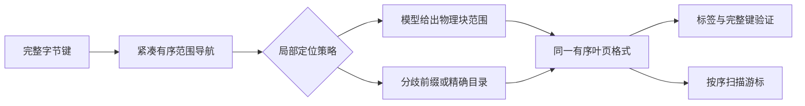

# 索引长期改进策略与实施路线

日期：2026-10-18。分析基点：`main@564df24`，当日本地与远程main一致，工作区起始干净。
路线依据的最近外部对照为2026-10-12的S3 c轮；本路线由只读数据审计与规划形成，后续A阶段执行记录见文末。

## 1. 决策

**以“有序物理叶页 + 可替换模型 + 保守纠错 + 局部维护”为长期主线。**
先做成可靠的静态读核心，再恢复有明确预算的局部更新。现有动态Context16保留作完整功能与维护成本对照。
投入优先顺序：集成归因限时收口 → 短键固定导航 → 长前缀辨识 → 静态采用验证 → 局部更新 → 配置收口。

原型已经证明改物理组织和预测目标能显著改善现有实现，学习型路径值得继续研究。
输入编码丢失的信息、模型之后的搜索和维护布局，需要与模型拟合一起解决。

本路线接替`NEXT_ACTION_PLAN_20261012_AFTER_STATIC_S3.md`的当前优先顺序，保留其7.8%回归和全部失败判定。
不开展LITS定向优化，不修改队友模型算法来迎合当前三份语料，不重开Q/PFX2/GD/M2等已关闭机制。

## 2. 当前情况：证据、解释与未知

### 2.1 实际存在两套结构

| 结构 | 当前用途 | 已有能力 | 主要不足 |
|---|---|---|---|
| 生产动态Index / Context16 | 兼容实现、动态成本对照 | 完整读写、扫描及既有维护机制 | 逻辑组与物理块不一致，普通构建为空组/写余量付费，部分查询遍历多块 |
| StaticPhysicalIndex | 新结构研究主体、显式只读接口 | 自持有bulk_load/find/scan，物理块预测和保守纠错 | 固定7符号编码失辨、导航仍有多级搜索、集成回归未归因、尚无局部更新 |

不能把只读原型的空间优势解释成保留相同更新能力的免费收益，也不能把历史动态更新结果当成新只读结构的证明。

### 2.2 当前速度距离

下表为S3 c轮回退实验的完整查询耗时比，ART=1；默认生产Index不在这张表里。

| 语料 / 键数 | 10k请求 | 100k请求 | 说明 |
|---|---:|---:|---|
| tranco / 262k | 1.145 | 0.938 | 请求工作集变化会改变排名 |
| mixed / 131k | 1.232 | 1.066 | 静态读仍落后 |
| skew / 131k | 1.021 | 0.810 | 长前缀回退有场景收益 |
| tranco / 64k | 1.385 | 1.368 | 小规模短键是明显短板 |

目标若定为所有这些单元不超过ART的1.10倍，64k tranco还需要约20%额外耗时下降，mixed/10k还需要约11%。
这是按已有比值计算的目标缺口，不是收益预测；后续必须用最终版本重新完整配对，不能把不同轮次加速比相乘。

### 2.3 根本瓶颈并非“工程优化太多”这么简单

1. **预测目标与存储单位曾经错位。** 旧模型先定位逻辑组，再进入组内块；新原型直接预测物理块。
   S2中tranco相对Context16+C减少约24%–26%耗时，说明结构重组的收益有实证，不应继续仅围绕旧组内流程修补。
2. **固定截断编码有信息上限。** 不同后缀前7个符号相同时，任何只读取该坐标的拟合器都不能辨别其不同位置。
   改段数/斜率不能恢复未读取的字节。这是编码与组织的约束，不能直接据此否定队友模型算法。
3. **少查块不一定更快。** mixed的100k请求中块访问764,708→169,701，但回退/learned=1.024。
   这与新增目录比较抵消节省相符，尚不能定量断言哪类缓存或分支开销占主导。
4. **短键必须摊销多道固定步骤。** 当前仍有区域摘要导航、前缀检查、段搜索、预测/纠错、CRC和最终验证。
   小规模短键的较大差距支持检查固定路径；尚未证明其中某一步占了多少纳秒。
5. **工程复杂度有真实成本，但归因尚未完成。** S3正式learned/skew/100k比旧原型慢7.75%，4/5同向，超过原门。
   多个其他单元也有1%–5%的中位偏慢；不能把全部差额归因于一次状态检查或一个指针，也不能用“其他格未失败”证明零成本。
   大量历史候选默认关闭，部分诊断在编译期剔除；开关数量不能直接代表本次热路径执行量。
6. **复现实验仍有本地依赖。** S3驱动依赖前轮未提交的ART/HOT对象，历史适配器还有自报身份滞后问题。
   新阶段应从固定源码自行构建本轮对象并绑定真实身份；一次解决必要依赖，不另建庞大评测平台。

### 2.4 本次新增的数据审计

定义：在当前区域前缀剥离、16条一块、7个9-bit符号编码下，统计“同坐标对应的完整fence前驱候选跨度>3块”的键。
这反映编码的结构性歧义，不是模型实际证书宽度，也不是查询时的回退概率。

| 数据 | 这种歧义覆盖的键 | 区域间分布 | 歧义簇额外公共前缀中位数 |
|---|---:|---|---:|
| tranco / 262k | 0.92% | 区域中位0%，最大33.35% | 7 B |
| tranco / 64k | 0.36% | 区域中位0%，最大8.79% | 7 B |
| mixed / 131k | 35.94% | 区域中位0%，最大100% | 14 B |
| skew / 131k | 99.93% | 所有区域≥97.71% | 13 B |

mixed存在很不同的区域，统一晚回退未必合适；skew的输入辨识能力普遍不足。
这是建设按局部数据特征组织路径的依据，不是已经证明某种新选择策略更快。

| 数据 | 10k请求命中的不同键 / 全库 | 100k请求命中的不同键 / 全库 |
|---|---:|---:|
| tranco / 262k | 3.37% | 29.07% |
| tranco / 64k | 12.78% | 74.56% |
| mixed / 131k | 6.63% | 49.67% |
| skew / 131k | 6.63% | 49.67% |

因此“100k请求”仍不等于全库遍历或冷读。现有排名与工作集有关，但没有PMU，不能仅凭这些比例确诊缓存未命中。

审计源码：`07_Eval_Integration/diagnostics/audit_static_strategy.py`；结果：
`07_Eval_Integration/results/strategy_audit_20261018/summary.json`。逐项校验既有查询的presence/value和输入哈希。

## 3. 目标结构与长期约束

1. **物理叶页是共同单位。** 模型以实际块fence与块号为训练目标，不再先制造逻辑空组。
   第一轮沿用16条/块和现有arena布局；没有访存证据前不重做标签面板或搜索块宽度。
2. **模型是可替换部件。** 索引负责键域、前缀/编码、块布局、纠错和所有权；模型负责预测与可声明的误差能力。
   队友模型、当前分段模型、精确目录必须能在相同布局上比较。
3. **无辨识能力时不强制先算模型。** 研究在构建时识别碰撞簇，直接给出必要的局部纠正范围。
   短键常见路径不应承担长前缀场景的整套状态与元数据；策略不能读取语料名、测试路径或预存查询答案。
4. **有序和精确语义贯穿全过程。** 任意字节、NUL、空键、前缀关系、缺席和scan lower_bound都以独立字节序参考校验。
   预测只能缩小搜索范围；无法证明覆盖时必须安全纠正，不能返回近似位置充当命中。
5. **维护局部化。** 静态类型保留紧凑布局；未来动态类型复用叶页格式/定位契约，使用局部arena、页级重建与稳定范围边界。
   当前全局arena的32-bit偏移不适合直接叠上局部可变长插入；不能把搬移全库伪装成局部更新。

内部定位契约最少明确：所属键区间、物理块范围、坐标前缀条件、缺席覆盖方式、模型/布局身份。
不可变快照不额外逐查询验证源码哈希；动态失效绑定页版本与发布状态。先写契约与最小接缝，避免先造一个大框架。

## 4. 实施阶段与推进条件

以下为约8–10个开发周的预算顺序，按单人串行集成估计；阶段失败会改变后续安排，不是交付日期承诺。
结构实现每次只保留一个新机制；模型侧可依照契约独立准备，代码合入与计时保持串行。

| 阶段 | 预算 | 主要产物 | 进入下一阶段的依据 |
|---|---|---|---|
| A 集成归因 | 2–3天 | 一份反事实归因记录；有证据才有最小修复 | 回归解释/修复，或明确标记未知并冻结实验接口 |
| B 物理定位契约 | 3–4天 | 可替换的定位接缝、同布局精确目录控制 | 两种现有定位方式通过同一正确性检查，避免重构损失 |
| C 短键导航 | 1–2周 | 一个减少依赖搜索的新候选 | 主目标完整查询收益成立，无清晰风险回归 |
| D 长前缀辨识 | 1–2周 | 碰撞簇分歧前缀处理及有界安全回退 | 同布局模型与目录比较有净收益或选择机制成立 |
| E 静态采用验证 | 约1周 | 简表、空间账本、泛化结果、明确适用配置 | 正确性与速度/空间预算同时通过 |
| F 局部更新 | 2–3周 | 独立动态类型、页级增量/合并/分裂 | 更新语义、读放大、重建工作量和峰值都受控 |
| G 配置收口 | 约1周，可随E/F收尾 | 少量正式配置、说明与可复现入口 | 最终集成版本重新完整验证，旧结果不冒充新版本 |

### A：先解释7.8%，给诊断设上限

1. 固定S3核心、输入、编译选项，保留c轮失败判定。先检查优化后指令路径、是否额外调用、CRC与模型/窗口/块验证工作量。
2. 仅在需要时做旧/新核心×旧/正式包装的2×2诊断；统一所有权和编译条件，保留同实例A/A。
   所有臂通过同一虚接口；额外直接调用仅作归因，不能与ART正式排名混合。
3. 先skew/100k主格，tranco/mixed作风险格，不再扩展全部历史组合。不删除构建前状态检查来追求好看数字。
4. 找到实际额外工作才改一次；以新版本完整A/B验证。无依据则2–3天收口为“未知集成成本”。
5. 未解释的回归继续阻止默认采用，但不无限阻塞C/D的结构研究；研究使用冻结实验分支/版本，采用资格独立判断。

### B：让队友模型接入真正可比较

1. 从已有实现明确物理块fence序列与块号定义，先保持布局与构建参数固定。
2. 当前分段预测器与精确目录通过同一定位契约；样本必须包含缺席区间、坐标等值族和边界。
3. 接队友模型时，优先尝试给它物理块fence训练样本，使预测目标直接对应块号，避免“键排名→逻辑组→物理块”的额外映射。
4. 编码前缀、实际算法版本、目标单位分别记录；编码固定丢信息时不对模型算法作优劣结论。
5. 不假设训练点最大误差覆盖所有缺席键。无全域保证的模型只能作为搜索hint，需独立可验证纠错；同布局目录始终作控制。

### C：先减少短键必须经过的步骤

主目标固定为tranco/64k及mixed/10k；full tranco和skew作风险格。

1. 将区域定位、段搜索、纠正比较、CRC字节、块进入列成一次完整查询的工作账本；计数不转换成伪分段耗时。
2. 检查能否由一次范围导航同时选中物理块定位单元，减少当前“区域搜索后再搜索模型段”的依赖层数。
3. 只有证明可以省去实质工作且完整键区间可认证，才建立一个导航原型。保留父范围纠正，完整处理间隙/前缀键。
4. 对短小范围允许精确定位先于模型；是否采用由同布局完整查询决定，不预设所有叶页必须学习化。
5. 初轮不改编码宽度、16槽几何、哈希算法或编译ISA；不把旧表合并/前缀缓存负结果换名字重开。
6. 主格至少10%耗时下降、≥4/5同向且超过A/A观测带才推进；其他格>5%且同向/超带的回归阻止通用采用。
   入门失败即关闭该具体机制；总目标仍需后续最终版本验证，单轮通过不等于已经追平ART。

### D：补辨识信息，再谈模型精度

1. 对连续同坐标fence簇记录额外共同前缀、完整键上下界与物理块范围；审计已表明skew常见额外前缀约13B。
2. 第一候选是在这些簇内验证进一步公共前缀后，读取真正分歧的后续符号，再在该局部范围定位。
   不是把全局7字节改成另一个固定宽度，也不改变字符串字典序。
3. 前缀条件不满足、EOS/高位字节边界或局部编码仍碰撞时，使用父范围精确纠正；深度和元数据设上限，不无限递归。
4. 对构建时已知无法形成小范围的单元，研究直接精确定位，避免“无效模型+晚回退”串行成本。
   初期显式策略优先，不先引入一套复杂成本学习器；若做自动选择，仅用构建数据，训练/验证输入分开。
5. 首先量化能覆盖多少宽范围、减少哪些依赖比较、增加多少常驻。新增元数据超过当前静态常驻5%或没有实质纠正工作减少则停。
6. 进入计时后比较同布局旧learned/旧回退/新机制。skew为收益目标、mixed和tranco为风险格；计数改善而完整查询无净收益仍判失败。

### E：证明适用范围，同时补齐空间口径

1. 日常筛选复用现有8格、90%命中、同重复配对，不为每个候选重建大矩阵。
   新驱动自行构建/验证固定版本外部依赖，不要求读者先拿到本机遗留.o；旧证据和旧脚本保持其原始身份。
2. 只有候选通过筛选，再补：一条无放回全库命中遍读；短键及长前缀的100%/0%命中端点；区间内扰动和区域边界缺席。
3. 暖态与“驱逐缓冲后首遍”分别报告；没有物理缓存证据不把后者宣称为严格冷缓存。
4. 用少量控制数据分离键长、额外共同前缀和分布集中度；不把三份语料的差别全归于平均长度。
   固定少量单因素对照，不做键长×偏斜×命中率×缓存状态的全笛卡尔积。
5. 增大到百万键级仅在真实输入足够时做一次规模检查；不足则标记未覆盖，不通过复制键/改变唯一键语义制造规模。
6. 一次性补ART分配请求字节及适配器载荷空间；内存计数独立构建，不把计数器开销带入性能排名。
   分别报告索引字节、适配器字节、输入保留、分配器未知部分、峰值。拿不到完整口径时继续标记未知。
7. 静态工程目标：当前必测格每格≤ART的1.10倍；进阶目标为至少两格≤1.00，其中至少一格来自tranco/64k或mixed/10k。
   不能只用已有100k优势格满足进阶目标，也不能靠平均值掩盖单格退化。
   元数据新增目标≤5%，静态常驻增长上限10%，构建耗时增长上限20%；这些是未来目标，不是S3已有成绩。
   达不到通用门而场景稳定时，只发布明确场景配置和局限，原生产默认继续保留。
   静态采用指正式发布只读配置，不替换动态API；动态默认改变须F阶段完成后通过同能力对照。

### F：以局部页维护恢复动态能力

1. 新建独立动态类型，复用页内有序记录和定位契约。初始页大小先沿用现有2048键尺度，避免同时搜索页尺寸。
2. 每页保留不可变基底和有上限的小型有序增量；增量只存最新值/删除标记。干净页不做全局增量探测。
3. 点查在目标页核对增量与基底；insert重复保旧、update缺席不插入、erase缺席不变，值0/MAX不表示缺席。
4. scan按页合并两路有序记录，消除被覆盖值和墓碑，严格满足lower_bound与limit，返回自持有键。
5. 增量达到预先登记的字节/条目预算时只合并该页；先建新页和新模型，再发布，失败不破坏旧页。
6. 页界采用拥有字节的稳定分隔符；删除最小键不使边界悬空。分裂/合并更新相邻范围和导航身份。
   若顶层更新仍是O(区域数)的数组搬移/重建，必须如实记录，不声称全流程局部化。
7. 局部arena避免每次插入搬移全局后缀。显式计算“原页+新页+增量+路由”峰值；32-bit限制按局部页设计，整库容量另定义。
8. 正确性对照std::map，含插入新边界、删除后重插、连续分裂、全删、失败重建，以及跨页扫描；sanitizer通过后才计时。
9. 首轮只做95/5与80/20读写、均匀与集中写、固定键数替换与增长；对照动态Context16及能力匹配的ART/HOT。
   单列查询、维护、扫描、重建字节、事件暂停与内存，不以维护总吞吐掩盖读退化。
10. 研发目标：相同当前map下，对重建后的只读快照查询开销≤15%；长期未合并增量字节≤基底10%；重建工作量随脏页而非全库增长。
    这些是预算。若桥接方案做不到，关闭该增量组织，再评估页内写余量；不继续叠全局缓存和多层增量来补救。

### G：收口成少量可解释配置

保留兼容动态、已证明的只读、满足维护门的局部动态三类明确能力；场景策略由数据特征/显式配置决定。
新内核不继承所有历史候选开关。负结果与旧源码留归档，热路径只保留有证据的机制。
最终表必须同时说明速度、常驻、构建/维护峰值、扫描和支持操作，不把不同能力的产品混成一个最佳数字。

## 5. 执行纪律与停止条件

- 每轮先登记目标格、唯一差分、输入、空间预算、通过/停止条件；正确性零失配是前提。
- 使用同接口、同实际查询、同状态、同重复配对；A/A观测带不是置信区间。
- 主效果未超过观测带则记“未分辨”，不把它当零成本或可靠收益，不靠增加重复挽救候选。
- 装置有独立可解释缺陷才修正并另名运行，保留原记录；不为好看结果选择性采用轮次。
- 没有PMU仍可做反事实与工作量归因；不虚构缓存/TLB/分支百分比。
- 每轮交付一页比较表、原始证据、采用/关闭结论；文档与测量工程不占据结构实现主线。
- 总体失败也有交付：若静态多阶段仍无法跨场景接近ART，明确发布空间/维护有优势的适用范围，结束“通用替代ART”目标。

## 6. 第一周的具体顺序

1. 第1天：固定S3 c的失败、源码与输入；检查真实find路径及工作量对等性，建立最多2×2归因臂。
2. 第2–3天：只做主格归因，有实际额外工作才修复；否则提交未知原因记录，冻结实验接口。
3. 第3–4天：写出物理块定位/缺席纠错契约，接当前模型与精确目录控制；避免大面积文件迁移。
4. 第4–5天：记录短键的两级搜索工作、可合并的键区间边界和元数据预算；给出C阶段唯一候选的入口判定。
5. 周末交付：归因结论、契约、一个候选的继续/停止决定、简表与仓库同步。不是再做一次完整七方矩阵。

## 7. 证据与结构参考

本地实证优先：

- [S2物理块原型](../07_Eval_Integration/RESULTS_STATIC_PHYSICAL_20261012.md)：物理布局、模型增量与只读取舍。
- [S3正式接口](../07_Eval_Integration/RESULTS_STATIC_INTERFACE_20261012.md)：8格性能、集成回归与能力边界。
- [队友模型入口](../07_Eval_Integration/RESULTS_BLOCK_RANK_ENTRY_20261011.md)：当前移植映射的碰撞/集中问题，不等于上游算法无效。
- [既有目录路径诊断](../07_Eval_Integration/RESULTS_DEPTH_DIR_READ_PATH_ENTRY_20261011.md)：更多目录比较可抵消块数下降；旧轮数字不直接搬给新核心。
- [本次审计](../07_Eval_Integration/results/strategy_audit_20261018/summary.json)：结构歧义与查询覆盖率，无时钟。

参考的是原则，不是移植后的收益承诺：

- [ART原论文](https://db.in.tum.de/~leis/papers/ART.pdf)强调按实际分支规模使用紧凑节点；本地固定libart的节点类型与前缀处理也可直接查源码。
  可借鉴数据驱动组织的原则，不能用论文数字替代本项目基线。
- [PGM官方接口](https://pgm.di.unipi.it/docs/cpp-reference/)将预测位置和保证搜索范围一起返回；其主体定义在有序数值上。
  本项目借鉴明确纠错契约，字符串编码、碰撞和缺席证明仍需自己完成。
- [ALEX论文](https://www.microsoft.com/en-us/research/wp-content/uploads/2020/04/MSRAlexTechnicalReportV2.pdf)将数据布局与动态扩张/分裂共同设计。
  [官方实现](https://github.com/microsoft/ALEX#limitations-and-future-research-directions)仅支持数值键，不能直接当作字符串替代品。

路线制定时A–G尚未开始。后续执行记录（2026-10-18）：

- A阶段完成一次冻结的反事实归因；三格已记录工作量逐查询相同，同包装规范化机器码相同；状态检查解释未获支持。
  原S3回归仍未解释，按A停止条件收口，不改核心/默认，不追加重复。见[执行结果](../07_Eval_Integration/RESULTS_INTEGRATION_ATTRIBUTION_20261018.md)。
- B首版接缝已实现及验收：[执行结果](../07_Eval_Integration/RESULTS_LOCATOR_SEAM_20261018.md)。共用128/128、四份普通/ASan/UBSan门通过，逐请求已记录工作零差分；六格无优化A/B均未分辨，对象新增8B。原S3/默认不改，队友模型尚未迁移。
- C1完整段切点融合导航[入口失败](../07_Eval_Integration/RESULTS_SEGMENT_NAV_ENTRY_20261018.md)：tranco比较总量近乎不变，mixed主格完整fence比较3.580→7.364次/请求；未进入完整查值原型/计时，关闭C1。8格440k请求及域门通过，短键目标尚未达成；下一步D长前缀辨识入口，D–G未执行。
