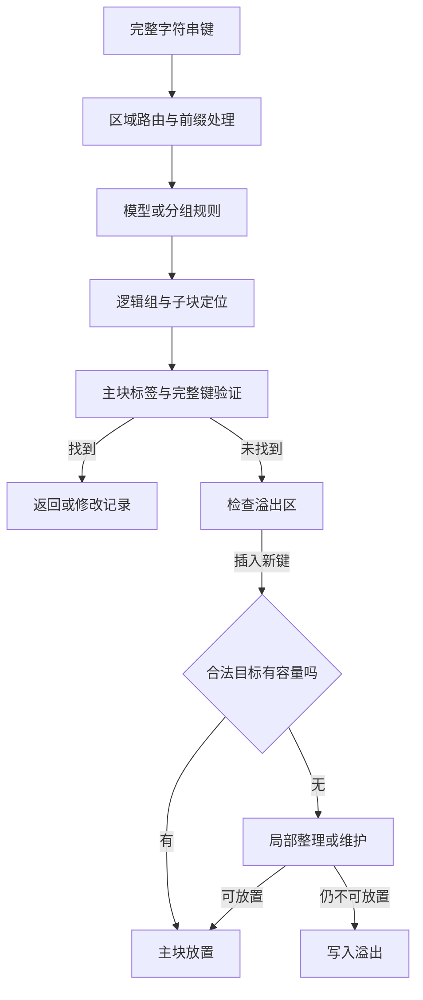

# 字符串学习型索引：结构审查与优化执行方案

日期：2026-09-20｜适用阶段：E29 之后｜性质：审查与实验任务书，非已完成的代码审计或性能报告。

本方案依据本会话中 E21–E29 的实验摘要，以及本次实际读取的 E3 历史源码。当前未取得 E29 最新源码、构建产物与原始记录，因此后续版本的实现和数字均按“用户报告”引用。所有新增改造均为待实现、待验证的方案，不覆盖现有冻结版。

## 0. 执行决定

先查清代码中的模型与分组实现，再用同一映射审查结构。第一条改造主线是 **目标子块内的后缀整理**，并独立评估已有溢出的迁回。不要同时替换模型、改变容量预算、重写溢出容器和增加节流，否则无法判断收益来自哪里。

本次要回答四个问题：

1. 当前程序实际用什么规则把字符串映射到逻辑组？它是否与论文模型或课题未来模型相同？
2. 查找慢，主要与预测成本、目录访问、候选验证，还是溢出访问有关？
3. 更新慢，主要与字节碎片、槽位限制、键范围约束、溢出容器搬移，还是维护粒度有关？
4. 在不增加主块预算的情况下，能否以可接受的维护成本保持空间利用率？

优先级如下；后续分支必须由诊断触发，不要求全部实现。

| 优先级 | 工作 | 进入下一步的条件 |
|---|---|---|
| P0 | 当前版本、模型来源、接口与正确性不变量审查 | 能说明真实调用链和实际配置；关键不变量成立 |
| P0 | 冻结版与 ART 的同轮基准、插入失败分层 | 数据来源一致；知道压力发生在哪些组与子块 |
| P1 | 单子块后缀整理 | 真实失败事件中存在较多仅靠本块回收就能成功的插入 |
| P1 条件分支 | 有界迁回既有溢出 | 本块整理后确有合法可容纳的溢出记录 |
| P2 条件分支 | 相邻子块重分配、区域内容量再分配、溢出容器调整 | 分别有对应的容量错配或搬移证据 |
| P2 条件分支 | 简化查找路径与扫描游标 | 当前版本仍存在可消除的重复访问或导航成本 |
| 后续独立线 | 接入开源参考模型或课题模型 | 模型接口契约明确，适配正确性通过 |

默认边界：单线程、内存索引、既有键值语义；模型研究不属于你的任务。并发、持久化和更宽 SIMD 不在首轮主线内。

## 1. 先纠正“有没有模型”的来源问题

### 1.1 本次已核实的历史源码事实

实际读取文件：`validation_e3_20260906/index.hpp`，SHA-256：

```text
56a8413f859f8cece698ab788fe79040181b783e35f04b7c9de377f828acfc4d
```

该历史版本存在以下实现：

| 源码对象 | 实际行为 | 可以得出的结论 |
|---|---|---|
| `ModelKind` | `Context16 / Position16 / Unigram` | 原型有三种模型配置 |
| `Model::train()` | 从区域键去掉公共前缀后的后缀统计字符分布，生成累计表 | 存在依赖输入数据的训练／统计构建，不是纯空接口 |
| `Model::predict()` | 按累计表递推数值区间，再转换成逻辑组号 | 存在可执行的预测路径 |
| `Region` 构造 | 调用 `model_.train()`；通过 `canonical_group()` 放置记录 | 构建依赖该预测实现 |
| 查找路径 | 调用 `model_.predict()` 后访问相应主块与溢出 | 查找与构建依赖映射一致性 |

可将其描述为“历史原型中的表驱动参考模型”。不能仅凭名字或相似思想称它为 LITS 官方模型，也不能断言当前 E29 仍逐字沿用它。

这解决一个概念混淆：**你不负责模型研究，不代表运行中的代码没有预测模块。** 此前“完全没有模型”的说法不准确；之前的实验也不能直接改写为“无模型版本与 ART 的比较”。

### 1.2 当前版本必须补齐的模型清单

沿实际正式 benchmark 的配置入口追踪，而不是只看类的默认值：

1. 外层区域如何选取？
2. 公共前缀何时计算，模型输入是完整键还是后缀？
3. 训练代码来自哪里，是否改写过，实际启用哪个模型配置？
4. 返回的是近似排名、连续坐标、物理位置，还是逻辑组号？
5. 逻辑组数如何确定，截断、早停、取整、限幅如何处理？
6. 构建、点查、插入、删除、扫描使用的映射是否一致？
7. 什么时候重训或改变组数？哪些记录必须重放？
8. 当前扫描是否依赖组号随字典序不下降？这种性质从何而来？

交付 `MODEL_AND_MAPPING.md`：列出函数、文件、配置、来源和边界。给出至少一条真实字符串从完整键到区域、后缀、组号和子块的诊断轨迹。

历史源码只能帮助确定检查入口。正式结论必须重新绑定当前源码哈希与当前可执行文件。

### 1.3 当前可以使用的证据与限制

| 证据 | 状态 | 对本轮的意义 | 不能推出什么 |
|---|---|---|---|
| E25 写路径改造有明显收益 | 用户报告 | 原型曾有可消除的实现成本 | 其余差距必然都是结构造成 |
| 长期等长替换时，活跃数固定而溢出、空间持续增长 | 用户报告，限已测检查点 | 需要检查动态空间复用机制 | 空间会无限增长，或所有工作负载都会退化 |
| E29 C3 减少溢出和空间，但完整操作耗时为冻结版的 1.45–6.02 倍 | 用户报告，same 负载 | 整组整理具有明确的时间—空间取舍 | 查询也变慢，或所有读写比例下均不合算 |
| E28 F1 失败可行率较高 | 用户摘要，部分文字截断 | 值得先验证局部整理 | 最新源码中的精确可行条件已经证明 |
| E3 有训练与预测实现 | 本次源码确认 | 当前审查不能从“没有模型”出发 | E29 与 E3 的模型配置相同 |

不在本方案拼接 E21、E25、E26、E29 的比值来制造一个“最终版 vs ART”总成绩。

## 2. 审查对象：一条访问路径与一条维护路径

以下是待与当前源码逐项对齐的结构图，不是已经完成的 E29 调用图。



工程审查不以“函数个数少”为目标。减少一次函数调用不一定减少实际访存；增加一张目录也可能减少大量后缀比较。最终以相同语义下的完整操作成本衡量。

### 2.1 各层必须查什么

| 模块 | 首要检查 | 重点成本 | 首轮处置 |
|---|---|---|---|
| 外层区域目录 | fence 定义、首尾边界、分裂后同步、重复定位 | 比较字节、目录访问、维护更新 | 先量当前成本；不直接换 ART 路由 |
| 前缀与模型 | 前缀变化、映射一致、训练来源、输入长度 | 预测字节、表访问、训练空间 | 固定当前正确实现，单独记录 |
| 逻辑组 | 记录数和后缀字节需求分布 | 拥挤、闲置、跨组空间不可用 | 区分“记录不均”与“字节不均” |
| 子块目录 | 边界所有权、空块、范围定位和回退 | 目录定位、串行块访问 | 验证范围导航能否减少访问 |
| 主块布局 | 槽位、后缀偏移、水位、垃圾、对齐 | 复制、局部碎片、描述符移动 | 首选本块字节整理 |
| 溢出容器 | 排序、判重、保留容量、删除释放 | 比较、搬移、分配、二次查找 | 先证明成本，再决定容器改造 |
| 更新控制流 | 定位复用的寿命、重建、分裂、异常路径 | 维护范围、峰值、停顿 | 不得通过绕过维护获得收益 |
| 扫描 | 任意起点、有序归并、输出所有权 | 导航、归并、完整键构造 | 输出语义保持一致 |

### 2.2 ART 对照应该解释什么

ART 用自适应节点类型、路径压缩和按键字节选择子节点组织访问。Node16 的 SIMD 比较用于选择孩子，与你的指纹过滤不是同一语义。可以借鉴它“按局部需求选择表示”的原则，但不能把完整树结构的优势拆成几个开关后假定已全部吸收。[ART 原论文](https://db.in.tum.de/~leis/papers/ART.pdf)

对 ART 的审查只需记录本次使用实现的路径深度、节点类型、分配与更新行为，不把“ART”当成所有成熟实现的统一代名词。不要宣称 ART 没有复制、重分配或长键验证成本。

## 3. 正确性不变量：先把允许改变的边界写下来

| 编号 | 不变量 | 建议验收方法 |
|---|---|---|
| I1 | 同一键在相同映射状态下，构建与查找得到同一逻辑组 | 逐键对比放置组与查询组；含未命中新键 |
| I2 | 若扫描依赖组序，分组映射满足所需的字典序性质 | 理论契约检查＋有序键相邻差分；测试不是证明的替代 |
| I3 | 每个活跃键恰好出现一次；值和公开 API 返回语义正确 | 独立参考有序表，逐条比对 |
| I4 | 子块范围与目录导航不漏掉可能命中的记录 | 所有边界、两键之间、首尾外、空中间块 |
| I5 | 槽位数、描述符区、后缀区与块边界合法 | 偏移检查、有效区间不重叠、对齐检查 |
| I6 | 标签与其所代表的键字节、哈希上下文一致 | 构建、移动和查询分别核对；碰撞仍需完整判等 |
| I7 | 整理不改变原有记录集合与值 | 整理前后逐条比较；再单独检查新插入 |
| I8 | 有限作用域定位结果不跨越使它失效的修改 | 变更后重取槽位；测试目录重建、压缩和分裂 |
| I9 | 模型、前缀或组数变化后，不直接沿用旧映射缓存 | 记录映射版本与受控生命周期；禁止仅用数组长度作身份 |
| I10 | 维护失败不丢记录、不重复发布、计数不半更新 | 准备—验证—提交；可控失败注入 |
| I11 | 只改值不改变键布局与空间计数 | 值更新控制组前后状态检查 |
| I12 | 扫描返回满足同一比较器的 lower_bound 起点语义，最多 n 条 | 独立参考表、完整键值、任意起点与 n=0 |

二进制键正确性与 ART 性能对照的共同键域分开。若 ART 适配器只在无 NUL 的 ASCII 子集上可靠，则性能对照明确受限；原型正确性测试仍保留自身承诺支持的字节域。

重排描述符、移动后缀、删除边界记录，都可能使 `string_view`、指针或偏移失效。即使键值没变，也必须审查目录和调用方保存的位置。

## 4. 诊断协议：先确定成本与空间在哪里

### 4.1 必须分离的三种构建

| 构建 | 用途 | 允许的内容 |
|---|---|---|
| correctness | 功能与结构验收 | 断言、参考表、结构遍历；可用时 ASan/UBSan |
| diag | 执行工作量和空间核算 | 比较字节、复制量、分配配对、失败分类、可用硬件计数 |
| timing | 正式性能 | 算法必需的判断和元数据，关闭纯诊断计数与内存包装 |

若算法本身需要维护 live bytes 或布局版本，该成本不能因为关闭诊断就被删掉。不得用有记账的旧路径和无记账的新路径比较。

### 4.2 查询成本：同一混合序列中的事件统计

在固定查询序列上，对每条查询记录其在各变体中的真实来源：主块命中、溢出命中、未命中。来源可能随布局变化，不能用变化后的桶均值直接声称同一类查询变快。

两种视图同时给出：

- **固定键队列视图**：按基线的来源划分同一批查询，在各变体里追踪工作量变化。
- **变体自身视图**：每个变体的真实来源比例，以及每类查询的工作量。

诊断字段：区域定位次数、预测次数和处理字节、子块目录比较、实际访问子块数、SIMD 批次数、标签候选数、完整比较次数和逻辑比较字节、溢出进入率与探测数。按每查询归一，并报告尾部分布。

另外跑纯命中、纯未命中，可以回答不同负载表现，但这两趟耗时不能加权当成混合那一趟的分解。查询顺序、工作集大小、分支历史和缓存状态都可能不同。

不逐键插入多个时钟。可用独立采样剖析或诊断微基准定位热点，但微基准耗时不能从端到端直接相减得到“精确模块成本”。若预计算组号来探索剩余路径，其额外数组读取与缓存效应必须标注；该实验既不是真实预测，也不是严格加速上界，不能加入 ART 排名。

### 4.3 更新成本：按完整公开操作记账

覆盖 `update_existing`、`insert_absent`、重复插入、`upsert_hit/miss`、`erase_hit/miss` 和删除后补入。更新与插入语义必须与基线对齐。

每个操作记录：

1. 定位／预测次数、哈希字节、完整比较次数和字节。
2. 目标组与候选子块、槽位失败／字节失败／范围拒绝的独立标志。
3. 描述符移动条目数与字节、后缀复制字节、溢出搬移量。
4. 子块整理、整组整理、区域重建、分裂、回退统一布局次数。
5. 每次维护处理的记录数、实际回收量、是否使当前插入成功。
6. 分配／释放次数、临时峰值，以及失败后是否仍进入溢出。

同一失败可能同时涉及槽位与字节，不先强制归为单一原因。后续另给互斥的“最小成功修复级别”。

### 4.4 空间账本：区分空闲总量和合法可用量

至少保存到区域、逻辑组、子块三个层级。对每个主块采用互不重叠的账本：

```text
块分配字节 = 块头 + 预留描述符区 + 后缀区 + 单列的对齐/尾部余量
后缀区     = 活跃记录占用 + 已消耗但可回收区域 + 从未分配的空闲区
```

若实现已把对齐算进后缀区，不再次加到合计。记录对齐填充归入哪一项必须一致；“活跃占用”应区分有效后缀字节与其分配占用。

用记录区间排序、间隙合并独立计算活跃占用和已用区间的空洞，再与水位路径比较。若垃圾只是总量减去其他项，明确它是派生值，不能把同一个等式重排后称为独立验证。

溢出空间分开列：活跃描述符、容器保留容量、字符串分配、元数据。区分 SSO 字符串对象内存与额外堆分配，避免重复计费。

全索引同时给出索引自有空间、共享输入缓冲、构建临时峰值、维护临时峰值、RSS。RSS 只作单列观测，不与前几项相加。

### 4.5 分组质量：不只数每组有几条记录

分别计算组级记录需求和字节需求的分位数、最大值及拥挤占比，并给出查询加权和更新加权的版本。区分“记录拥挤组”与“访问热门组”。

对有溢出的组，再细分空闲来自：目标子块、同组其他子块、同区域其他组、其他区域。只有合法放置规则允许利用的空闲，才计入某种改造的可恢复容量。

不要把预测排名误差直接等同为吞吐损失。记录数均匀也不保证字节需求均匀；同一组号分布在不同键长分布下会形成不同存储压力。

## 5. 插入失败分层：用真实试放确定最小修复范围

从诊断运行采集真实失败事件及其插入前快照。在独立副本中按下表试放。分类针对同一个键、同一个状态；副本创建和试放不进入正式计时，也不改变随后被计时的状态。

以下 A0–A5 是本审查新增的分类名，不覆盖 E28 的 F1/F2 定义。表格记录每层的可行性向量，再以首个成功层生成互斥分类；各层成功率不可直接相加。

| 层级 | 允许改变什么 | 保持什么 | 要回答的问题 |
|---|---|---|---|
| A0 原路径 | 不改变状态 | 全部 | 是否真的是失败事件？ |
| A1 本子块整理 | 仅回收合法目标子块的后缀垃圾 | 记录归属、槽数、块大小、映射 | 单块碎片是否足以解释失败？ |
| A2 相邻子块重分配 | 调整相邻块内记录分界与存放 | 逻辑组、合计预算、映射 | 是否因子块间槽位／字节／键序错配？ |
| A3 整组重排 | 调整组内物理放置 | 逻辑组与该组预算、映射 | 小范围处理不足时，整组是否实际可行？ |
| A4 区域内容量再分配 | 在本区域的组间转移物理预算 | 区域总主块预算、逻辑映射 | 是否为跨组容量错配？ |
| A5 仍失败或未判定 | 不直接扩容掩盖问题 | 记录失败原因 | 单键过长、实现限制、总量必要条件失败，还是规划器未找到方案？ |

**必要条件通过不等于真实可放置。** 总字节够，不保证每个子块都满足槽位和范围约束。正式的“可恢复”标签须由实际安全放置或与实现等价的可行性算法确认。

反过来，启发式规划器失败也不能证明数学上无解。A5 必须区分：必要条件已违反、已证明不可行、搜索未找到、当前实现不支持。

采样如需限量，应按数据集、检查点、失败类型及组压力分层，记录抽样率。不能只保留容易恢复的事件来计算收益。

## 6. 首选改造：目标子块内的后缀整理

### 6.1 改造目标与范围

新增内部能力 `compact_subblock(group, block)`，只整理插入目标子块。第一版不跨子块移动原有记录，不调整组号，不增加主块预算，不自动迁回既有溢出。

原有整组维护作为明确的后续回退路径保留，但每次是否进入、花了多少工作必须单独计数。不得把“先局部整理，失败后又整组整理”的叠加成本漏掉。

该方案检验的是：能否把为了一个插入而重放整个组，改成只复制目标块内的活跃后缀。尚不能承诺它一定胜过冻结版。

### 6.2 正确的触发条件

对当前规则允许的目标子块定义：

- `F`：当前可直接分配的连续后缀字节。
- `G`：本块整理确实可回收的字节。
- `R`：待插入记录的实际新增存储需求，包括实现必要的终止符、对齐和填充。
- `S`：可用描述符槽位。

在已确认 `F + G` 就是整理后可用量的情况下：

```text
键允许进入这个子块
且 S > 0
且 F < R
且 G >= R - F
```

若对齐规则或变长条目使简单加法不成立，改用实际计算的 `free_after_compact >= R`。加法和偏移更新要防溢出。

**不使用“垃圾字节 ≥ 完整键长”。** 例如 R=156 B、F=120 B、G=40 B，整理后 160 B 足够；要求垃圾达到 156 B 会拒绝本可成功的插入。这里的 156 B 仅是容量示例，不代表重复前缀数据实际存入主块的后缀长度。

这里的垃圾必须来自同一目标子块，不能借用全组或全索引垃圾来通过判断。若允许多个合法候选块，枚举范围须遵守现有范围不变量，不因哪里有空位就随意放过去。

### 6.3 准备、验证、提交

建议第一版用一个块大小的临时缓冲，换取清晰的异常安全；临时分配和复制计入完整维护成本。

```text
try_insert(record):
    完成当前公开操作要求的定位与判重
    按合法规则选候选子块
    若原路径可放下：直接插入
    否则若本块整理条件成立：
        读取本块活跃描述符，验证边界
        在临时缓冲中紧凑复制活跃后缀
        保留原键值、标签和逻辑槽序，计算新偏移
        验证新布局能容纳原有记录及本次新增需求
        提交原有记录的新布局并刷新地址相关引用
        重取已失效的位置，重试本次插入
    若仍未成功：沿明确记录的既有回退路径处理
```

实现注意事项：

1. 若指纹对应的字节与哈希上下文不变，沿用 C1 的标签复用；不因纯搬运重新训练或预测。
2. 纯后缀整理保持逻辑槽序，尽量避免额外描述符重排。
3. 边界键若以指针或视图保存，必须刷新；不能只因键内容不变就忽略目录。
4. `Located` 内的槽位、后缀引用和溢出迭代器按各自失效规则处理，不把“本次公开操作内”误当成永远有效。
5. 零长度后缀、极长后缀、恰好填满、偏移窄类型溢出均需明确处理。
6. 准备阶段失败时保留旧状态。提交后若本次插入仍失败，应报告原因；不能默默把“不满足可行性”当作正常收益。

### 6.4 首轮不同时增加节流

压缩次数增加不等于缺乏节流：如果每次都承接了有效插入，频繁整理仍可能合理。先报告：

```text
整理成功率 = 整理后本次插入成功数 / 整理次数
单位回收复制量 = 复制的活跃字节总数 / 实际回收字节总数
维护复制负担 = 所有维护复制字节 / 完成的更新操作数
```

分母为零时写“不适用”，不强行生成比值。另报告最大及高分位的单次搬移工作量。

若出现同一布局状态反复进行无收益尝试，才引入独立节流变体。失败缓存至少要考虑布局版本、失败类型和所需空间；大键失败不能阻止后来更小的键尝试。不能简单缓存“这个块失败过”，也不先拍定每 100 次操作才整理一次。

### 6.5 正确性门与归因边界

必须专门构造：F≥R、G<R 但 F+G≥R、精确等于、字节仍不足、槽位满、只有别块有垃圾、删除首末条目、空中间块、同标签碰撞、重复失败、整理后更新与扫描、失败注入。

每个用例用事件计数证明分支真实触发，并以独立参考表核对结果。既要保证内容正确，也要保证不借用别块容量。

新方案相对 C3 同时改变了触发判据和整理范围。因此端到端差值是组合效应。若要单独归因“粒度”，用相同快照中两种方案均可行的事件作成对诊断，并单列不重合事件；不把该筛选后的诊断当成完整负载成绩。

## 7. 条件改造分支：每个分支都有明确入口

### 7.1 有界迁回溢出：解决已经退化的状态

**入口证据：** 子块整理后，已有溢出中存在符合该块范围、槽位和字节约束的记录。

仅优化新插入，通常不能自动降低过去累积的溢出。为此另做 `drain_overflow_bounded`，与“只整理、不迁回”比较：

- 根据子块键范围在有序溢出中定位候选，不每次遍历全部溢出。
- 明确每次最多检查多少候选、复制多少字节、迁回多少条；跳过放不下的记录也消耗预算。
- 先准备放置，再一致地更新主块、溢出及计数；失败不能丢记录或重复保留。
- 不跨逻辑组迁记录，不偷偷改变查询必须访问的集合。
- 明确何时触发：删除后、成功整理后或检查点维护。首版只选一种触发位置。

验收除了迁回数量，还要计入候选搜索、溢出删除搬移、保留容量是否释放、点查与扫描变化。若容器删除比迁回本身昂贵，不能以“主块利用率提高”判定划算。

增加一项“修复旧状态”实验：先用冻结版生成 200% 替换后的快照，再分别不维护、局部整理、有界迁回。它与从初始状态运行新策略是不同问题，结果分开呈现。

### 7.2 相邻子块重分配：解决同组内部错配

**入口证据：** A1 失败，而 A2 在足够多真实压力事件中成功；失败确与邻块间的槽位、字节或键范围分界有关。

第一版仅取目标块及一个相邻块，合并其按键有序的记录和待插入键，寻找新的合法切分点。每个候选切分同时满足左右槽数、实际后缀占用和边界限制；先用线性枚举切分点写清正确版本。

选择目标优先为成功放置，再减少搬移字节，并可保留一定空闲余量。先固定规则，不在测试查询上调目标权重。

旧布局在双块新布局完整准备前保持可用；一次提交目录边界。块总字节和逻辑组不变。若数据跨块后涉及不同前缀编码，须重算实际存储需求，不能直接加旧长度。

退出条件：多数失败仍由组级总容量或单键过长造成，或双块搬移持续增加操作成本而没有明确空间收益。此时不无条件扩大到三个、四个块。

### 7.3 本块空洞复用：整理仍过于频繁时的替代线

**入口证据：** A1 可行且有效，但长期负载中重复复制同一批活跃后缀成为主要维护工作；删除留下的洞尺寸与新后缀需求有较高匹配率。

可试验本块小型空闲区间表或长度分级空洞表，让插入直接复用洞，而非每次紧凑化。该方案需要合并相邻洞、处理小碎片、维护水位与偏移；元数据和搜索成本全部入账。

这是对连续后缀分配方式的独立改造，不能与 A1 第一版一同启用。若后缀占用短且元数据相对太大，或空洞匹配率低，则停止。它也不会解决槽位不足。

### 7.4 区域内容量再分配：解决跨组空闲不可用

**入口证据：** A1–A3 不能恢复，A4 在相同区域主块预算下可行；空闲确实集中在其他逻辑组。

保持模型和组号映射不变，只改变各组的物理容量或块归属。先利用目录间接寻址，设计可重建的容量方案；不把“组分裂改变映射”混为本变体。

必须记录：规划与数据迁移耗时、目录更改、预算守恒、旧布局与新布局并存峰值、受影响键数、查询导航成本。

触发不能只看全区域平均装载率。候选条件应结合持续的局部压力、可借用容量和上次再分配后新增变化量。阈值只在独立调参序列上确定，再冻结测试。

不要承诺现有整段连续存储一定能只搬目标组。若调整一个组大小会迫使整个区域搬移，这本身就是结构审查结果；需要把“连续大区＋偏移”与“独立块池＋目录”另作对照，完整计入多一次间接访问和分配管理。

### 7.5 溢出容器：用搬移证据决定是否换组织方式

**入口证据：** 局部整理后，替换仍主要消耗在溢出有序向量的插入、删除搬移或字符串分配，而非主块维护。

可先比较“小型有序分块容器”与原向量，或“稳定记录存储＋有序句柄”。不要直接同时引入哈希表、墓碑、增量区和后台合并。

每种候选必须保留完整判重和扫描语义。稳定句柄减少记录移动，却增加间接访问和元数据；无序增量区减轻写入，却增加读取检查和扫描归并。不能只测写速度而不测读与空间。

如果实际搬移的是短描述符而不是长后缀，要分别计数。不能凭 `vector::erase` 推定整个字符串字节都被复制。

Masstree 使用排序置换来组织节点内键的逻辑顺序，可借鉴“逻辑顺序与物理位置分离”的思路；其 15 槽、64 位置换表示不能直接照搬到你的多子块／48 槽布局，也不意味着需要引入其并发机制。[Masstree 原论文](https://pdos.csail.mit.edu/papers/masstree:eurosys12.pdf)

### 7.6 点查路径与扫描：独立于空间维护的分支

**点查入口证据：** 当前冻结版存在大量可避免的子块遍历、重复外层定位，或导航需要多次长字符串比较。

- 核实 E11/E13 的子块范围定位是否实际启用，不能把已有机制重新写成新创新。
- 对目录边界做紧凑编码或前缀片段缓存时，保留等值全比较；前缀碰撞数据必须单独报告。
- 测只读元数据工作集和间接访问；若使用硬件计数，单列其运行，不把采样程序的时间当正式成绩。
- 若考虑把预测结果再映射到额外目录，核算它是减少候选还是增加一层串行依赖。

**扫描入口证据：** 当前仍有重复起点定位或每次跨块重建游标。先消除已确认的重复工作，再考虑保存一次扫描内的区域／组／子块／溢出归并状态。

返回 `string_view` 与返回拥有所有权的完整字符串是不同接口。可以增加只读游标实验，但必须让有序数组等对照采用同样语义，不能用零拷贝版本去比较对方物化完整键的版本。

本轮不把空组位图列为默认工作：E27 报告中实际空组访问为零；只有新状态出现明确空组成本才重开此方向。

## 8. 模型模块：核查与对接，不转移你的研究职责

### 8.1 先把模型作为明确的外部组件

建议接口规范包含以下内容；这是契约草案，不是要求重写现有类。

```cpp
// 示意：实际类型和返回语义以当前源码核查结果为准。
struct MappingContract {
    InputDomain input_domain;      // 完整键还是区域后缀、字节域
    OutputKind output_kind;       // 坐标、排名或逻辑组号
    bool order_preserving;        // 明确的契约，不能仅靠标志自证
    uint64_t mapping_version;     // 在受控生命周期内使用
};

struct PredictorAdapter {
    void build(TrainingKeys keys, MappingConfig cfg);
    Prediction predict(ByteView key) const;
    size_t allocated_bytes() const;
};
```

具体契约还需约定：空串和 EOS、公共前缀剥离、浮点异常与取整、域外键、新键、逻辑组数、重训时机、状态所有权和变更通知。指纹可以与预测融合计算，但不能把融合得到的成本误记为“哈希消失”。

映射变了，记录位置通常需要重建或兼容迁移。仅换模型对象、保留旧物理记录会产生错查；新增上下文必须绑定正确的键序列与生命周期，不能再次把弱摘要或数组长度当完整身份。

### 8.2 如需开源参考模型，另立一条适配线

LITS 将全局 HPT 与节点局部线性模型组合，用于字符串定位；这是候选参考模块，不是当前原型已等价实现它的证据，也不是下载即可无缝接入的承诺。[LITS 原论文](https://www.shimin-chen.com/papers/LITS-pvldb24.pdf)

先验证原生模型输出的语义和必要依赖，再接入你的存储层。提取模型与引入完整 LITS 索引分开命名；完整 LITS 只能作为外部系统基线，不能冒充“你的结构＋同一模型”。

如果以后确实加入新模型，做小型 2×2 对照：

|  | 当前结构 S0 | 候选结构 S1 |
|---|---|---|
| 当前映射 M0 | 基线 | 固定 M0 的结构收益 |
| 新参考映射 M1 | 固定 S0 的模型替换影响 | 组合影响与交互 |

固定数据、外层区域划分和主块预算；各臂按其合法映射重新构建，训练时间、模型内存和维护一并计入。若 M1 必须改变组数或区域划分，不能再称纯模型消融，要另外说明改动。

模型替换导致更均衡的记录分布，不代表字节需求或动态寿命分布也更好。其效果仍由端到端和空间测量决定。

## 9. 正式比较：内部因果对照与 ART 外部对照分开

### 9.1 首轮最小变体集

| 实验名 | 配置 | 用途 |
|---|---|---|
| BASE | E25–E27 冻结配置，R1 构建；显式写出全部开关 | 当前真实默认基线 |
| GROUP | 同轮重编的 E29 C3 | 整组回收的时间—空间参照，不是默认候选 |
| LOCAL | BASE＋第 6 节的目标子块整理 | 首要候选 |
| ART | 固定提交版本与适配器 | 外部系统参照 |
| ARR | 全局有序数组 | 静态点查和扫描参照；动态操作只有语义完整且实现后才排名 |

有界迁回、相邻重分配等作为后续独立变体，不预先堆入 LOCAL。不同名字必须打印出真实配置差异；沿用 `require_only_switches_differ()` 一类检查，防止默认值翻转后两臂塌成一个实现。

根据已有冻结报告，BASE 应显式启用以下五项，并使用 R1 构建；SA0 必须核对当前源码是否仍如此：

```text
write_fast_locate      = true
reuse_locate_ctx       = true
compact_reuse_tag     = true
compact_needs_garbage = true
scan_reserve_result   = true
```

新子块策略不能被旧触发条件提前挡住而从未运行。应明确新增判断插入在哪个失败分支、与既有整组维护的先后关系，并用事件断言验证；这些开关并非任意组合都具有相同语义。

组预算、外层路由、预测配置、SIMD 与溢出策略，凡非本轮变量均固定。若改动必然影响其他项，明确把实验称为组合改造。

### 9.2 工作负载矩阵

| 负载 | 检查点／状态 | 核心问题 |
|---|---|---|
| 静态点查 | 初始；混合命中为主，纯命中／纯未命中辅助 | 是否引入新的查询代价？ |
| 只改值 | 0/5/10/25% | 控制组：布局和结构空间应保持不变 |
| 持续插入 | 0/5/10/25% | 新溢出、分裂、重建与维护成本 |
| 短期替换 | 0/5/10/25% | 与既有评估的负载形状一致，不跨轮拼数 |
| 长期替换 same | 0/25/50/100/200% | 等长条件下的空间复用与维护成本 |
| 长期替换 grow | 同上；记录生成键的长度上限与分布 | 字节需求变化与碎片效应如何交互 |
| 压力正确性序列 | 区域边界外新键、单区域集中、跨分裂阈值 | 强制触发正常随机负载未覆盖的维护分支 |
| 范围扫描 | 初始、25%、200%；建议 n=16/128/1024 | 短／长扫描、返回不足 n、空子块是否正确且可接受 |

每种负载独立从同一初始键值集合与配置开始。后续检查点表示同一条负载历史的继续，不能独立重建后冒充更新后的状态。

替换周期＝删除一个存在键＋插入一个不同且不存在的新键＝两个索引操作。报告同时写周期数、操作数和活跃记录数。

`same` 只保证长度或生成分布受控，并不自动保证组号分布相同；报告组级记录与字节需求变化。`grow` 不能让键无限增长。新键分布应覆盖内部位置，另外单列边界与单区域压力，不无意间只插末尾。

数据集名称和键数从元数据读出。Tranco 是来源名，不因数据来源包含百万域名就写“测试了一百万键”。历史出现过 262,144 键和不同规模的动态实验，必须逐轮注明真实数量。

### 9.3 状态快照与两套查询

每个检查点保留两套查询：

1. 固定键序列：重新计算存在性和值，报告真实命中率。
2. 固定命中比例：按当前存活集合和不存在集合生成，相同检查点各臂使用完全相同序列。

固定序列命中率下降与布局变化会混合影响成本，不能单独当作退化证据。查询进入回退统一容量区域的比例、这些区域承载的记录比例同时记录；区域个数不足以描述影响范围。

诊断复制和空间遍历可能预热数据。建议与计时运行分离；若不得不在同一进程采样，每次正式测量前采用一致的预热程序，不能让一臂因额外诊断获得缓存优势。

### 9.4 ART 的同语义要求

首轮至少核对以下条件：

- **计时入口**：双方都从完整字符串键开始，不给原型预先喂组号、不给 ART 提前查好的节点。
- **键值语义**：共同键域、同一值宽度、同样的重复键处理。ART 若用插入接口实现更新，要封装为相同的存在性语义并计入所需成本。
- **所有权**：一方复制键、另一方借用外部键时明确列出差异；同时报告各自必须常驻的键和值存储，不能只数树节点。
- **构建边界**：主表从同一份未加工输入开始，包含排序、去重、统计、训练、容量规划和最终构建中实际需要的步骤。另可提供排序后输入的辅助表，但不得与前者混用。
- **动态操作**：同操作序列、同初始状态；计时外生成键、维护参考表、检查答案。所有算法必需的复制、分配、压缩与目录修复均计时。
- **范围扫描**：相同 lower_bound 起点、最多 n 条、相同输出所有权。若 libart 适配器没有合适的范围入口，不用全树遍历硬凑排名。
- **平台与编译**：同编译器、ISA 目标、优化设置和分配器条件。若参考实现依赖其他指令集，单列环境，不冒充同预算实验。
- **记账**：干净时间构建不启用分配包装；空间诊断先校验覆盖的分配接口和释放配对，不把“分配减释放为零”当完整性证明。

独立参考表用于正确性，不把 ART 当唯一真值。只比较一个 libart 实现时，报告名称就是“该版本 libart”，不扩张成所有 ART。

### 9.5 时间统计和噪声处理

正式建议沿用至少 5 个独立进程，每进程 3 个重复，变体执行顺序平衡轮换。同一操作流的各臂在各自索引上从头重放；重复实验也必须恢复初始状态。相同种子重复运行主要检测测量波动，不代表覆盖了多种分布。

记录 CPU 型号、可用核心、绑核结果、宿主／虚拟化环境、编译器和系统版本。沿用冻结版的可复现编译目标，例如原协议的 `-O3 -march=x86-64-v2 -static`；若依赖导致必须变更，则各臂统一变更并作为新平台轮次，不与历史绝对值拼接。

点查按固定次数预热并校验结果，扫描对各臂使用相同预热规则。写操作预热不能提前改变被测初始状态：在牺牲实例上预热，再构建正式实例，或采用完整重放但丢弃的预热轮。页面与分配器状态仍可能不同，因此各臂顺序需要平衡。绑核和预热不能保证消除宿主噪声。

先安排小规模冒烟验证协议，再跑完整数据；不要在看到结果后选择性增加只对某个变体有利的重复。

记：

```text
r[p,j] = T_candidate[p,j] / T_base[p,j]
r[p]   = median_j(r[p,j])
主估计 = median_p(r[p])
```

同时报告每个进程的比值、最小／最大值、胜出进程数、各臂绝对耗时。若提供置信区间，以进程为分组单位；5 个进程不等于可以声称高精度统计显著。独立种子与跨进程重复的层次分别记录。

同一次重复内的配对比值才可比较。不能把 E25 的 V2/V1、E26 的 C2/C0、E27 的 S1/S0 相乘得到最终收益。

用同配置双实例作为 A/A 控制估计测量波动。若差异与噪声同量级，结论写“未能区分”，不能因多数格略小于 1 就默认启用。

同时报告累积耗时和检查点之间的区间耗时；后者必须除以该区间实际操作数。0% 检查点只做初始状态和查询，更新吞吐无定义。

主计时采用批量完整操作。维护尾部先报告复制字节／记录量分布；若需单操作 p95/p99，另设稀疏计时或单独延迟实验，记录时钟开销。批平均的 p99 不得写成单次操作 p99。

## 10. 如何判断“该保留哪个结构”

### 10.1 四个层次的判定

1. **正确性门槛**：任何漏查、错值、键序错误、预算违规或失效引用，均停止性能结论。
2. **机制门槛**：声称局部整理有效，就必须有真实可行插入、实际回收字节和可复核事件，不能只看压缩计数下降。
3. **性能门槛**：以完整操作与查询／扫描成本判断，收益须能够与本机测量波动区分。
4. **适用性门槛**：根据目标负载决定时间、空间和尾部的取舍；不要求每项全面超过 ART，也不隐瞒只在少数场景获益。

可以在实验前约定实用阈值，例如“目标负载维护时间下降至少 5%，查询退化不超过预设容忍值”。这些是项目决策阈值，不是统计定理；若噪声超过阈值，先换环境或保留候选，不直接判胜。不要根据结果反向修改门槛。

### 10.2 采用矩阵

| 观测 | 处置 |
|---|---|
| 空间降低，维护也更快，查询和扫描无明确不可接受退化 | 可进入默认候选，再做最终组合确认 |
| 空间降低，但维护变慢 | 保留为空间优先配置；用真实读写混合负载评估是否抵偿 |
| 新溢出减少，旧溢出不降 | 说明是预防收益；评估有界迁回，不称长期问题已经解决 |
| A1 高可行率，但局部整理仍慢 | 查复制量、临时分配与反复处理；必要时试本块空洞复用 |
| A1 低、A2 高 | 相邻子块分界或容量错配，进入双块试验 |
| A1–A3 低、A4 高 | 跨组容量错配，评估区域内再分配 |
| 溢出下降，但删除替换仍慢且搬移显著 | 独立评估溢出容器 |
| 维护改善，但点查差距不动 | 点查与维护是不同瓶颈，进入访问路径审查 |
| 只有替换模型后才出现收益 | 报告模型—结构交互，不把收益全归于结构 |
| 目标负载下 ART 的时间、空间、尾部均占优 | 工程采用 ART；研究如实报告结构的适用边界 |

### 10.3 E29 的“回不了本”怎样进一步检验

E29 已测口径支持 C3 在更新阶段更慢，但尚未计入读与扫描收益。若需要判断完整业务流程，可测：

```text
完整成本 = 初始构建 + 操作序列执行 + 在线维护 + 明确定义的检查点维护
```

将更新、点查、扫描按预先声明的比例实际交错执行。各操作独立测试均值的加权和只作粗略估算，因为交错会改变缓存和分支行为。

作为粗略规划，若维护多花 ΔT_m，且同状态同轮测得后续每次查询平均少花 δt_q，则 ΔT_m/δt_q 可作假设条件下的摊销查询数。δt_q 未测得为正时不给该数；真实决策仍以混合序列为准。空间受限收益也应在实际内存约束下测，不能凭主块命中率推断。

长期测试到 200% 仍是有限窗口。报告“在已测窗口增长／趋缓”，不写成已经证明无限运行稳定。若要研究稳态，另行扩展足够长的稳定分布负载并记录容量上界或重建策略。

## 11. 分阶段执行与停止条件

阶段编号使用 SA0–SA5，避免覆盖你已有 E30 或后续实验号。正式执行时可映射到新的实验目录。

| 阶段 | 工作 | 必交付结果 | 何时停止或转向 |
|---|---|---|---|
| SA0 来源与契约 | 当前源码、实际配置、模型接口、ART 适配器、构建闭环核查 | 版本清单、调用链、模型说明、不变量清单 | 当前源码或语义不明确时，不出新归因结论 |
| SA1 结构诊断 | 成本计数、空间账本、A0–A5 可行性、冻结版同轮基准 | 失败分层表、压力分布、ART 对照 | 若主要不是 A1，不强推子块整理 |
| SA2 最小局部原型 | 仅实现目标子块整理，先正确性再干净计时 | 事件断言、参考差分、BASE/GROUP/LOCAL 对照 | 正确性失败先修；无价值则保留负结果 |
| SA3 条件分支 | 按 SA1/SA2 选择迁回、双块、区域容量或容器中的一条 | 单变量或明确组合消融 | 首个有效方案足以回答问题后，不扩展无依据分支 |
| SA4 完整评估 | 最终候选 vs BASE/ART，点查、写入、替换、扫描、空间 | 同轮最终表、适用范围、风险 | 收益无法区分噪声则保持原默认 |
| SA5 冻结与交付 | 显式配置、默认入口确认、构建记录、报告导航更新 | 发布快照和未完成项 | 不在收尾临时加入模型或新优化 |

每阶段结尾都写检查点：当前版本、已完成门、有效结果、作废运行、下一条命令或任务、尚未解决的问题。长程执行在这些自然边界保存状态，避免只依赖聊天上下文续接。

首次可执行任务只到 SA2。SA3 不是要求一次做完所有候选；根据证据选择一条足够明确的结构变化。

## 12. 代码组织、数据字段与交付纪律

### 12.1 推荐的文件职责

| 文件或目录 | 职责 |
|---|---|
| `CODE_AUDIT.md` | 当前文件、函数、配置、来源与未决问题 |
| `MODEL_AND_MAPPING.md` | 模型来源、分组语义、扫描所需性质与对接契约 |
| `INVARIANTS.md` | I1–I12 与对应验收门 |
| `switches.hpp` | 显式基线和候选配置、允许差异断言 |
| `diag_structure.cpp` | 访问、维护、空间和失败试放；不进入正式计时 |
| `check_local_compact.cpp` | 新局部整理的定向分支、差分与失败路径 |
| `bench_structure.cpp` | 同语义、同进程成对实验与干净时间记录 |
| `analyze_structure.py` | 从一次指定运行生成全部正式表格 |
| `results/main/` | 选定正式运行；诊断、试跑、归档另存 |
| `RESULTS.md / LOG.md / TASK_STATE.md` | 结论、事故、限制及下一阶段状态 |

文件名为建议接口，不暗示这些代码已经存在。新目录引用冻结源码快照；旧 E29、E26 和此前正式结果保持原样。

### 12.2 每条结果至少绑定的身份字段

`run_id`、源码清单哈希、可执行哈希、编译命令、配置全文或其可追溯哈希、ART 提交与适配器哈希、数据哈希和实际键数、种子、进程号、重复号、执行顺序、负载、检查点、周期数、操作数、活跃数、计时构建类型、时间单位、校验和。

诊断字段另表保存，按同样的身份字段关联；不要把 `mem_build=true` 的记录放入性能汇总。检查点使用原始记录中的真实比例，不按最后一行归一化。

分析脚本必须拒绝：缺失臂、重复配对、配置意外相同、状态或操作数不一致、无效 JSON、旧可执行身份、计数构建混入、单位不一致和校验失败。

### 12.3 构建闭环与运行顺序

编译失败立即删除旧可执行文件及其成功记录，运行入口拒绝没有匹配构建身份的目标。批量构建逐个报告状态，不能因某个命令提前退出而把未尝试的目标当成功。

正式运行顺序：

1. 验证源码与构建配置；生成新二进制身份。
2. 定向新门通过，回归门通过；实际可用时补内存安全检查。
3. 冒烟验证时间表、检查点、配对关系和空间账本。
4. 正式计时；诊断独立执行；不要在正式过程中随意改源码。
5. 解析全部原始记录，自动生成结果表和证据链接。
6. 更新报告、清单与检查点；失效运行明确归档排除。

不把“回归日志相同”当内存安全证明；也不要求合理布局变化后所有内部计数仍逐字相同。需要保持的是公开语义、关键不变量，以及对计数差异的可解释性。

历史环境没有 sanitizer，不代表当前环境必然没有。先检查真实工具链；不可用就保留缺口，不能把普通差分测试写成等价替代。

### 12.4 最终结果表模板

| 数据与负载 | 版本／对照 | 完整耗时配对比 | 索引空间 | 维护峰值 | 溢出率 | 查询／扫描影响 | 来源与限制 |
|---|---|---|---|---|---|---|---|
| 待测 | LOCAL / BASE | 待测 | 待测 | 待测 | 待测 | 待测 | 同轮记录 |
| 待测 | LOCAL / ART | 待测 | 待测 | 待测 | 不适用于 ART 的项分列 | 待测 | 共同键域与 API |
| 待测 | LOCAL / GROUP | 待测 | 待测 | 待测 | 待测 | 待测 | 触发＋粒度组合差异 |

不预填加速目标或虚构预期值。内部结构指标在不同索引上不一定有对应概念；例如 ART 没有本原型意义下的溢出率，不能硬赋零后作为全面优越的证明。

## 13. 如何形成你的研究贡献

你的责任是索引结构、存储组织与工程实现。模型可以使用现有参考实现或由合作方交付；贡献不依赖你自创模型。

推荐的研究叙述链条是：

1. **发现约束**：固定映射与预算下，动态更新使可用空间在合法目标处不足。
2. **区分原因**：用可行性分层分清字节碎片、槽位、键范围、跨组容量和容器成本。
3. **提出局部机制**：用足够小的维护范围恢复合法放置能力，明确不变量和回退。
4. **证明收益与代价**：正确性、端到端时间、总空间、峰值及查询／扫描同时测量。
5. **划定边界**：说明在哪些负载优于冻结版、在哪些情况下仍应选择 ART。

“局部整理”“空闲空间管理”本身是通用思想，不能直接宣称独创。潜在研究价值在于：它们如何适配预测分组、双重槽位／字节限制与有序扫描，并以可复核证据说明取舍。

可用于汇报的阶段性表述：

> 当前将从局部实现优化转向结构审查，重点研究固定映射下的动态空间复用与维护粒度。先核实原型中的预测模块，再通过真实失败事件确定最小修复范围；优先验证目标子块整理，并以同轮 ART 对照评估时间、空间及长期更新行为。现阶段不预设模型或结构是全部性能差距的原因。

## 14. 执行前需要的当前材料

若要把本方案直接落到 E29 代码，需要：

- E29 实际使用的 `index.hpp`、模型与目录相关头文件、配置入口、`switches.hpp`。
- `check_c3`、最新写入／扫描门，以及 `bench_long`、`diag_long` 和键生成器。
- E28/E29 原始记录与分析器；至少保留失败分类和 C3 对照所需数据。
- 当前 ART 源码提交、适配器、构建脚本与分配记账代码。
- 冻结版完整清单、当前编译命令与一份能重建的环境说明。

本次已经完成的是方案编写和历史 E3 源码中的模型存在性核实。未修改当前冻结代码，未运行 E29 或新增结构实验。

## 15. 参考与证据说明

本方案中的算法、试验矩阵和验收建议是针对当前项目提出的设计方案，不是参考论文已证明适用于本原型的结论。

| 来源 | 本方案采用的内容 | 使用边界 |
|---|---|---|
| 本会话 E21–E29 用户报告 | 动态退化、既有优化、E29 时间—空间取舍 | 未取得最新原始记录复验；不填补截断内容 |
| 本次读取的 E3 `index.hpp` | 模型配置、训练、预测、构建调用的存在性 | 仅代表指定哈希的历史版本 |
| [ART 原论文](https://db.in.tum.de/~leis/papers/ART.pdf) | 自适应节点与路径组织的参考 | 不代表本次 libart 已启用所有机制 |
| [LITS 原论文](https://www.shimin-chen.com/papers/LITS-pvldb24.pdf) | 字符串参考模型的可能来源与模型／结构边界 | 不声称原型是其官方实现 |
| [Masstree 原论文](https://pdos.csail.mit.edu/papers/masstree:eurosys12.pdf) | 逻辑顺序与物理位置分离的参考思路 | 节点规模与并发设计不能直接移植 |

资料核对日期：2026-09-20。
